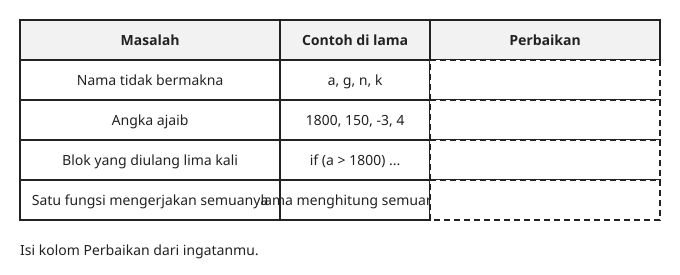

**Ingat dulu:** Tanpa melihat catatan, jawab. (1) Sebut tiga isi tabel pin pada dokumen perakitan. ______ (2) Mengapa uji dengan masukan jauh dari batas tidak menemukan galat `<` lawan `<=`? ______



`[Gambar: tabel tiga kolom (masalah, contoh di fungsi lama, perbaikan) dengan empat baris masalah: nama tidak bermakna, angka ajaib, blok yang diulang lima kali, satu fungsi mengerjakan semuanya. Kolom perbaikan kosong dan kamu isi.]`

**Prediksi:** Tebak dulu, tulis jawabanmu, baru telusuri. Fungsi `lama` menerima lima bacaan sensor. Sensor dianggap gelap bila bacaannya **lebih besar** dari ambangnya (1800, 2000, 1875, 2110, 1740). Bila tidak ada sensor gelap, atau semua gelap, `kiri` dan `kanan` bernilai 0.

1. Kelima bacaan sama dengan ambangnya masing-masing. Berapa `kiri` dan `kanan`? ______
2. Mengapa uji yang hanya memakai bacaan 800 di atas atau di bawah ambang tidak menangkap pergantian `>` menjadi `>=`? ______

**Lengkapi:** Isi `____` pada `jepit`, yang membatasi nilai ke rentang -batas sampai batas.

```cpp setengah-jadi
// C++17. Lengkapi bagian ____.
const int BATAS_MAKS = 15;
int jepit(int nilai, int batas) {
  if (nilai > ____) { return batas; }
  if (nilai < ____) { return -batas; }
  return ____;
}
```

**Susun:** Urutkan baris A sampai F menjadi isi `hitungGalat` setelah dirapikan (kurung kurawal penutup tidak ditulis).

```text
(A)     jumlah += POSISI[i];
(B)   for (int i = 0; i < JUMLAH_SENSOR; i++) {
(C)   int banyak = 0;
(D)     if (gelap(bacaan[i], i)) {
(E)       banyak++;
(F)   int jumlah = 0;
```

Urutanku: ______

**Latihan:**

1. `AI: tanpa AI` Fragmen ini sulit dirawat: `void k(int a,int b){ if(a>500){x=a*7/10;} if(b>500){y=b*7/10;} z=x+y; if(z>1000)z=1000; }`. Sebut tiga masalah pemeliharaan di dalamnya. ______
2. `AI: tanpa AI` Pada `proporsional`, seorang murid mengganti `-KP_PEMBILANG * galat / KP_PENYEBUT` dengan `-(KP_PEMBILANG / KP_PENYEBUT) * galat`. Prediksi: lolos uji karakterisasi atau tidak, dan mengapa? ______
3. `AI: boleh` Saat merapikan, kamu melihat `lama` tidak memeriksa bacaan di luar 0 sampai 4095. Haruskah itu diperbaiki di langkah refaktor yang sama? Jelaskan. ______

**Cek diri:**

- [ ] Saya dapat menjelaskan perbedaan refaktor dan perbaikan galat.
- [ ] Saya menulis uji karakterisasi sebelum mengubah program lama.
- [ ] Uji saya mencakup kasus tepat di batas.

**Catatan cetak (untuk guru, tidak dicetak):** satu halaman A4. Kunci ada di modul `c-xii2-m1` bagian "Kunci dan petunjuk". Lembar tidak memuat kolom identitas.
