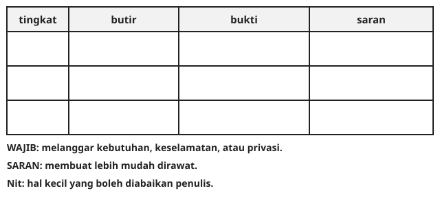

**Ingat dulu:** Tanpa melihat catatan, jawab. (1) Mengapa tiap perubahan penyempurnaan dibuat satu per satu dan diuji ulang? ______ (2) Mengapa log memakai penyangga melingkar, dan apa yang hilang bila penuh? ______ (3) Sebut dua ongkos memadatkan data, dan mengapa lebih kecil tidak selalu lebih baik. ______



`[Gambar: tabel kosong empat kolom (tingkat, butir, bukti, saran) dengan tiga baris isian. Di bawahnya arti tiga tingkat: WAJIB bila melanggar kebutuhan, keselamatan, atau privasi; SARAN bila membuat lebih mudah dirawat; Nit bila hal kecil yang boleh diabaikan penulis.]`

**Prediksi:** Tebak dulu, tulis jawabanmu, baru jalankan. Kode di bawah milik kelompok karangan dan memuat cacat yang sengaja ditanam. Kebutuhan K2: simpangan terbesar paling besar 25 mm. Baca dan catat temuanmu pada formulir sebelum melihat keluaran.

```cpp
// C++17. Kode yang diulas; ada cacat yang sengaja ditanam.
#include <iostream>
int s[5] = {12, 25, 18, 20, 9};  // simpangan terbesar tiap lari, mm
int f() {
  int m = 0;
  for (int i = 0; i < 5; i++) {
    if (s[i] > m) {
      m = s[i];
    }
  }
  return m;
}
int g() {
  int j = 0;
  for (int i = 0; i < 5; i++) {
    j += s[i];
  }
  return j / 5;
}
bool ok() { return f() < 25; }
int main() {
  std::cout << "terburuk " << f() << " mm, rata-rata " << g() << " mm\n";
  std::cout << (ok() ? "K2 LULUS" : "K2 GAGAL") << "\n";
}
```

Apa keluaran program? ______ Apa yang akan kamu catat, dan pada tingkat apa? ______

**Latihan:**

1. `AI: tanpa AI` Baca kode dan dokumen kelompok lain tanpa menjalankannya dan tulis prediksi perilakunya. Titik periksa: prediksi bertanggal sebelum menjalankan. ______
2. `AI: boleh` Tulis tiga catatan ulasan pada formulir. Tiap catatan memuat tingkat, butir, bukti, dan saran; tidak ada catatan "kurang bagus" tanpa butir. ______
3. `AI: tanpa AI` Dari modul `c-xii2-m5`: tulis satu uji yang akan menangkap cacat `<` melawan `<=` di atas, lengkap dengan id kebutuhannya. ______
4. `AI: tanpa AI` Dari modul `c-xii2-m9`: setelah pembekuan fitur, ulasan menemukan fitur yang "enak ditambah". Apa yang kamu tulis pada catatan? ______

**Cek diri:**

- [ ] Tiap catatanku menyebut tingkat, butir, bukti, dan saran.
- [ ] Aku menelusuri kebutuhan ke uji, bukan hanya membaca kode.
- [ ] Aku memeriksa keselamatan dan privasi.

**Catatan cetak (untuk guru, tidak dicetak):** dua halaman A4. Bagian Lengkapi dan Susun dilewati karena modul ulasan sejawat tidak memuat contoh setengah jadi atau soal Parsons. Kunci ada di modul `c-xii2-m10`, bagian "Kunci dan petunjuk". Lembar tidak memuat kolom identitas.
