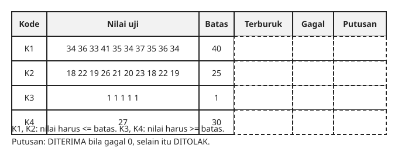

**Ingat dulu:** Tanpa melihat catatan, jawab. (1) Apa beda catatan WAJIB, SARAN, dan Nit? ______ (2) Mengapa nilai tepat di batas harus ada pada data uji? ______

`[Gambar: tabel empat kebutuhan (K1 waktu 2 m, K2 simpangan terbesar, K3 berhenti saat garis hilang, K4 lama beroperasi) dengan nilai uji dan batas. Kolom terburuk, gagal, dan putusan kosong. K1 dan K2 harus kurang dari atau sama dengan batas, K3 dan K4 harus lebih dari atau sama dengan batas.]`

**Prediksi:** Tebak dulu, tulis jawabanmu, baru hitung. Dari data pada gambar, berapa dari empat kebutuhan yang akan ditolak? ______ Apakah rata-rata K1 dan K2 cukup untuk memutuskan? Mengapa? ______ Isi kolom terburuk, gagal, dan putusan pada gambar.

**Latihan:**

1. `AI: tanpa AI` Tulis protokol ujimu: lintasan, baterai, jumlah ulang, penguji, dan tanggal. ______
2. `AI: tanpa AI` Tulis nilai dan putusan yang kamu harapkan untuk tiap kebutuhan proyekmu sebelum menguji. ______
3. `AI: boleh` Satu lari buruk muncul pada data. Sebut dua jalan tindak lanjut yang sah, dan satu hal yang tidak boleh dilakukan pada lari itu. ______
4. `AI: boleh` Dari `c-xii2-m4`: apakah data yang dicatat pada ujimu memuat pengenal orang? Bagaimana kamu memeriksanya, dan apa yang tidak dibuktikan oleh pemeriksaan itu? ______

**Cek diri:**

- [ ] Protokol ujiku ditulis sebelum menguji dan dapat diulang orang lain.
- [ ] Laporanku memuat terburuk, jumlah gagal, dan putusan per kebutuhan.
- [ ] Tiap kebutuhan menunjuk uji dan sebaliknya.

**Catatan cetak (untuk guru, tidak dicetak):** satu halaman A4. Kunci ada di modul `c-xii2-m11` bagian "Kunci dan petunjuk". Lembar tidak memuat kolom identitas.
