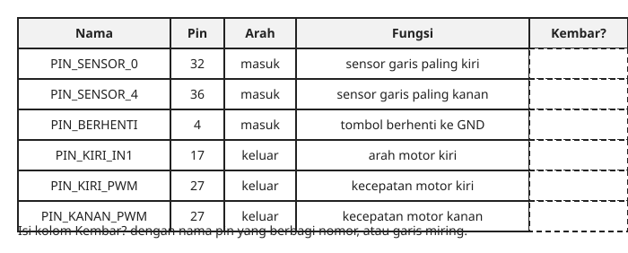

**Ingat dulu:** Tanpa melihat catatan, jawab. (1) Mengapa laporan uji memuat nilai terburuk, bukan hanya rata-rata? ______ (2) Apa beda rilis kandidat dengan rilis akhir? ______ (3) Apa arti "tidak ada temuan" pada pemindai, dan apa yang tidak dibuktikannya? ______

`[Gambar: tabel enam pin (PIN_SENSOR_0 32, PIN_SENSOR_4 36, PIN_BERHENTI 4, PIN_KIRI_IN1 17, PIN_KIRI_PWM 27, PIN_KANAN_PWM 27) dengan arah dan fungsi, dan kolom kembar kosong.]`

**Prediksi:** Tebak dulu, tulis jawabanmu. Tabel pin dibangkitkan dari daftar pin bernama dan program memeriksa pin kembar. Berapa peringatan yang muncul, dan pin mana? ______ Mengapa pemeriksaan ini tidak membuktikan nomor pin benar untuk papanmu? ______

**Latihan:**

1. `AI: boleh` Tulis daftar dokumen yang dibutuhkan proyekmu, pembacanya, dan tujuannya. ______
2. `AI: tanpa AI` Bangkitkan tabel pin dari daftar pin bernama proyekmu; tulis prediksi jumlah pin kembar sebelum menjalankan. ______
3. `AI: boleh` Sebut apa yang dimuat panduan pengguna: cara mulai, cara berhenti, dan tiga hal lain. ______
4. `AI: boleh` Dari `c-xii2-m8`: data apa yang boleh dan tidak boleh ada di panduan pengguna tentang log? ______

**Cek diri:**

- [ ] Tabel pinku dibangkitkan dari daftar bernama dan tidak ada nomor kembar.
- [ ] Dokumenku memuat versi, riwayat, dan daftar yang belum beres.
- [ ] Dokumenku tidak memuat rahasia atau pengenal orang.

**Catatan cetak (untuk guru, tidak dicetak):** satu halaman A4. Kunci ada di modul `c-xii2-m12` bagian "Kunci dan petunjuk". Lembar tidak memuat kolom identitas.
