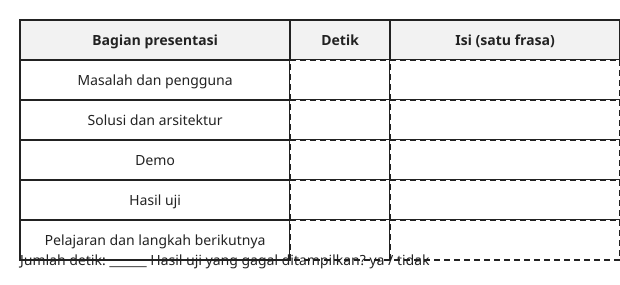

**Ingat dulu:** Tanpa melihat catatan, jawab. (1) Mengapa tabel pin dibangkitkan dari daftar pin bernama yang sama dengan program? ______ (2) Mengapa kata sandi jaringan tidak ditulis di dalam program yang masuk repositori? ______ (3) Mengapa fitur yang boleh dipotong ditulis sejak rancangan? ______

`[Gambar: tabel lima bagian presentasi (masalah dan pengguna, solusi dan arsitektur, demo, hasil uji, pelajaran dan langkah berikutnya) dengan kolom detik dan isi kosong, lalu tempat menulis jumlah detik.]`

**Prediksi:** Tebak dulu, tulis jawabanmu. Pemindai arsip mencari pola `kata_sandi=`, `token=`, `nama,`, `email,`, dan `@` pada isi berkas karangan berikut.

| Berkas | Isi |
| --- | --- |
| robot.cpp | `const int HILANG_MAKS = 3;` dan `const char *kata_sandi="jangan-ini";` |
| data-lari.csv | `tick,keadaan,koreksi` dan `0,DIAM,0` |
| data-uji.csv | `nama,waktu` dan `tokoh-a,34` |
| panduan.md | `Kontak: tim@kelas.example` |
| catatan.txt | `Tokoh Contoh dari kelas XII-Z memegang robot saat uji.` |
| laporan-uji.md | `K1 DITOLAK pada lari 4; K2 DITOLAK pada lari 4.` |

Berapa temuan pemindai? ______ Berkas mana yang memuat data pribadi tetapi tidak tertangkap? ______ Mengapa kamu tetap membaca setiap berkas sendiri? ______

**Latihan:**

1. `AI: boleh` Susun naskah lima menit pada tabel di gambar dengan waktu yang berjumlah 300 detik. ______
2. `AI: tanpa AI` Tulis prediksi apa yang terlihat pada demomu, satu langkah yang bisa gagal, dan cadangannya yang berjalan tanpa papan. ______
3. `AI: tanpa AI` Dari `c-xii2-m11`: rata-rata K1 35 detik tetapi terburuk 41 detik terhadap batas 40. Tulis satu kalimat jujur untuk penonton. ______
4. `AI: boleh` Dari `c-xii2-m4`: apa yang kamu lakukan sebelum arsip dibagikan bila kata sandi jaringan pernah ada di riwayat repositori? ______

**Cek diri:**

- [ ] Naskahku berjumlah tepat 300 detik dan memuat hasil yang gagal.
- [ ] Arsipku bebas rahasia dan pengenal, dan aku membacanya sendiri.
- [ ] Atribusi dan lisensiku tertulis.

**Catatan cetak (untuk guru, tidak dicetak):** satu halaman A4. Kunci ada di modul `c-xii2-m13` bagian "Kunci dan petunjuk". Lembar tidak memuat kolom identitas.
