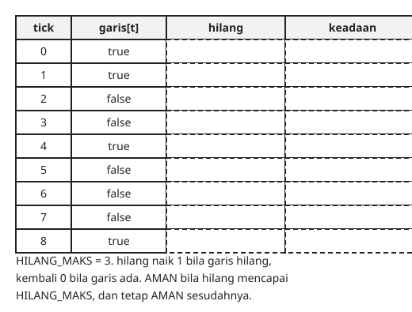

**Ingat dulu:** Tanpa melihat catatan, jawab (`AI: tanpa AI`). (1) Mengapa hasil uji yang gagal tetap ditunjukkan pada presentasi? ______ (2) Mengapa batas kebutuhan tidak boleh diubah diam-diam setelah melihat hasil? ______ (3) Mengapa roda diangkat dan tombol berhenti dipasang sebelum motor dinyalakan pertama kali? ______



`[Gambar: tabel sembilan baris tick 0 sampai 8 dengan nilai garis[t] diberikan (true, true, false, false, true, false, false, false, true); kolom hilang dan keadaan kosong untuk diisi.]`

**Prediksi:** Telusuri dulu di kertas, baru jalankan. Program ini membaca `garis[t]` untuk tiap tick dan memakai `HILANG_MAKS = 3`.

```cpp
#include <iostream>

int main() {
  const bool garis[] = {true, true, false, false, true, false, false, false, true};
  const int HILANG_MAKS = 3;
  int hilang = 0;
  bool aman = false;
  for (int t = 0; t < 9; t++) {
    if (!aman) {
      hilang = garis[t] ? 0 : hilang + 1;
      if (hilang >= HILANG_MAKS) {
        aman = true;
      }
    }
    std::cout << "tick " << t << ": " << (aman ? "AMAN" : "MAJU") << " hilang=" << hilang << "\n";
  }
}
```

Isi tabel pada gambar. Pada tick berapa robot masuk `AMAN`? ______ Pada tick berapa bila `HILANG_MAKS` diganti 2? ______

**Latihan:**

1. Uji penerimaan: sepuluh lari menghasilkan simpangan terbesar (mm): 20, 24, 25, 22, 25, 19, 21, 23, 18, 25, dengan batas K2 25 mm. Beri putusan, tulis rata-ratanya (dipangkas ke bawah), dan tulis dua kalimat laporan yang jujur. ______
2. Matriks proyek karangan: K1 (2 m paling lama 40 detik), K2 (simpangan terbesar paling besar 25 mm), K3 (berhenti di `AMAN` bila garis hilang), K4 (beroperasi paling sedikit 30 menit), K5 (tanpa data pribadi). Uji: U1 menguji K1; U2 menguji K2; U3 menguji K3; U4 menguji K6. Temukan kebutuhan tanpa uji dan uji tanpa kebutuhan, lalu tulis perbaikannya. ______
3. Log di robot muat 4 catatan dan menimpa yang tertua. Tick 1 sampai 7 dicatat dan tidak ada pengiriman. Berapa catatan tertimpa, dan tick mana yang tersisa? Apa yang perlu dilaporkan ke server saat akhirnya terkirim? ______

**Cek diri:**

- [ ] Saya menelusuri kebutuhan ke uji dan sebaliknya.
- [ ] Saya menelusuri mesin keadaan dan penyangga melingkar tanpa menjalankannya.
- [ ] Saya memutuskan penerimaan dari nilai terburuk dan nilai tepat di batas.

**Catatan cetak (untuk guru, tidak dicetak):** satu halaman A4. Kunci ada di modul `c-xii2-m14` bagian "Kunci dan petunjuk". Lembar tidak memuat kolom identitas.
