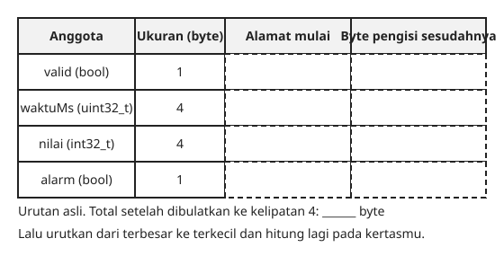

**Ingat dulu:** Tanpa melihat catatan, jawab. (1) Apa yang dibuktikan uji karakterisasi setelah refaktor, dan apa yang tidak dibuktikannya? ______ (2) Mengapa kriteria selesai ditulis sebelum mengerjakan? ______



`[Gambar: tabel empat anggota rekaman (valid bool 1 byte, waktuMs uint32_t 4 byte, nilai int32_t 4 byte, alarm bool 1 byte) dengan kolom alamat mulai dan byte pengisi kosong, lalu tempat menulis total byte.]`

**Prediksi:** Tebak dulu, tulis jawabanmu, baru telusuri. Anggap anggota 4 byte harus berada di alamat kelipatan 4 dan seluruh struktur dibulatkan ke kelipatan 4.

1. Berapa byte satu rekaman bila urutannya seperti pada gambar? Berapa bila diurutkan dari terbesar ke terkecil? ______
2. Bila rekaman diganti dua `uint16_t`, berapa byte untuk 600 rekaman? ______
3. Apa batas masa rekam bila waktu disimpan sebagai detik dalam `uint16_t`? ______

**Lengkapi:** Isi `____` pada pengemasan nilai 12 bit dan bendera `valid` di bit 12.

```cpp setengah-jadi
// C++17. Lengkapi bagian ____.
const uint16_t MASKER_NILAI = 0x0FFF;
const uint16_t BIT_VALID = 1u << ____;
uint16_t paket(int nilai, bool valid) {
  return static_cast<uint16_t>(nilai & ____) | (valid ? ____ : 0);
}
int nilaiDari(uint16_t p) { return p & ____; }
```

**Susun:** Urutkan baris A sampai E menjadi inti uji pulang-pergi (kurung kurawal penutup tidak ditulis).

```text
(A)       RekamPadat r = padatkan(1234, nilai, valid, alarm);
(B)   for (int nilai = 0; nilai <= 4095; nilai++) {
(C)     for (int b = 0; b < 4; b++) {
(D)       bool valid = (b & 1) != 0;
(E)       if (nilaiDari(r) != nilai || validDari(r) != valid) { salah++; }
```

Urutanku: ______

**Latihan:**

1. `AI: tanpa AI` Struktur `{uint8_t a; uint32_t b; uint8_t c; uint16_t d;}` dengan aturan penjajaran seperti pada Prediksi: berapa byte? Berapa bila diurutkan `b, d, a, c`? ______
2. `AI: tanpa AI` Papan punya memori bebas jauh lebih besar dari 9600 byte. Haruskah kamu memadatkan? Beri dua pertimbangan. ______
3. `AI: boleh` `padatkan(0, 4096, ...)` memberi nilai 0 diam-diam. Tulis perubahan pada `padatkan` agar nilai di luar 0 sampai 4095 menandai rekaman tidak valid, dan dua nilai uji tambahan. ______

**Cek diri:**

- [ ] Saya mengukur ukuran sebelum dan sesudah tiap perubahan.
- [ ] Saya menguji bahwa isi data tidak berubah.
- [ ] Saya tahu kapan tidak mengoptimasi adalah pilihan yang tepat.

**Catatan cetak (untuk guru, tidak dicetak):** satu halaman A4. Kunci ada di modul `c-xii2-m2` bagian "Kunci dan petunjuk". Lembar tidak memuat kolom identitas.
