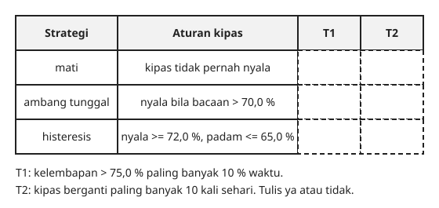

**Ingat dulu:** Tanpa melihat catatan, jawab. (1) Mengapa kamu mengukur memori sebelum mengubah program? ______ (2) Apa beda kebutuhan yang dapat diuji dengan sekadar harapan? Beri contoh. ______



`[Gambar: tabel tiga strategi kipas gudang fiktif (mati, ambang tunggal, histeresis) dengan aturannya, dan kolom T1 serta T2 kosong untuk diisi ya atau tidak.]`

**Prediksi:** Tebak dulu, tulis jawabanmu, baru telusuri. Gudang alat olahraga fiktif cepat lembap. Kelembapan diukur tiap 10 menit selama sehari (144 pembacaan); sensor berderau sekitar 2 poin persen. Tujuan karangan T1 dan T2 tertulis pada gambar.

1. Strategi mana yang paling sering mengganti kipas, dan mengapa derau memengaruhinya? ______
2. Apakah rata-rata kelembapan saja cukup untuk memilih strategi? Mengapa? ______
3. Menurutmu, adakah strategi yang memenuhi kedua tujuan? ______

**Lengkapi:** Isi `____` pada keputusan histeresis: nyala bila 720 atau lebih, padam bila 650 atau kurang, di antaranya tetap seperti sekarang.

```cpp setengah-jadi
// C++17. Lengkapi bagian ____.
bool keputusanKipas(bool kipasSekarang, int bacaan) {
  bool baru = kipasSekarang;
  if (bacaan >= ____) { baru = true; }
  if (bacaan <= ____) { baru = false; }
  return ____;
}
```

**Susun:** Urutkan baris A sampai E menjadi isi satu langkah simulasi strategi histeresis (baris `<= 650` tidak ditulis).

```text
(A)     lembap = lembap + (luar(t) - lembap) / 8 - (kipas ? KIPAS_TURUN : 0);
(B)     int bacaan = lembap + DERAU[t % 8];
(C)     kipas = baru;
(D)     if (bacaan >= 720) baru = true;
(E)     bool baru = kipas;
```

Urutanku: ______

**Latihan:**

1. `AI: tanpa AI` Isi lembar pemodelan ringkas (satu baris per bagian: masalah dan pengguna, tujuan, masukan dan keluaran, asumsi, tidak dimodelkan, data, uji, keputusan) untuk: tanaman pot fiktif kering saat libur. ______
2. `AI: boleh` Untuk masalah itu, tulis dua tujuan dengan angka, satuan, dan cara ukur, lalu satu prediksi hasil sebelum menguji. ______
3. `AI: tanpa AI` Dengan `KIPAS_TURUN` diubah menjadi 20, prediksi: apakah langkah buruk histeresis turun di bawah 15 (10 persen dari 144)? Bagaimana pergantian kipas? ______

**Cek diri:**

- [ ] Tujuan saya punya angka, satuan, dan cara ukur, dan dapat gagal.
- [ ] Saya menyatakan asumsi dan hal yang tidak dimodelkan.
- [ ] Saya membaca hasil uji model dengan jujur, termasuk saat tujuan tidak tercapai.

**Catatan cetak (untuk guru, tidak dicetak):** satu halaman A4. Kunci ada di modul `c-xii2-m3` bagian "Kunci dan petunjuk". Lembar tidak memuat kolom identitas.
