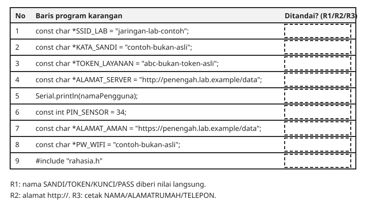

**Ingat dulu:** Tanpa melihat catatan, jawab. (1) Mengapa perbaikan galat dipisahkan dari refaktor? ______ (2) Mengapa arus saat motor macet lebih penting daripada arus rata-rata untuk memilih pengendali motor? ______



`[Gambar: daftar sembilan baris program karangan bernomor 1 sampai 9, dengan kolom kosong di kanan untuk menulis R1, R2, atau R3 pada baris yang ditandai pemindai. Aturan R1, R2, R3 tertulis di bawah daftar.]`

**Prediksi:** Tebak dulu, tulis jawabanmu, baru telusuri.

1. Baris mana yang ditandai pemindai? ______
2. Baris mana yang sebenarnya masalah tetapi lolos? ______
3. Apakah baris 9 (`#include "rahasia.h"`) masalah? Mengapa? ______

**Lengkapi:** Isi `____` pada pemeriksa aturan R2 (alamat `http://`, bukan `https://`).

```cpp setengah-jadi
// C++17. Lengkapi bagian ____.
bool memuat(const std::string &s, const std::string &kata) { return s.find(kata) != ____; }
bool pakaiHttpTanpaEnkripsi(const std::string &baris) { return memuat(baris, "____"); }
```

**Susun:** Urutkan baris A sampai E menjadi pembuka perulangan pemindai (kurung kurawal penutup tidak ditulis).

```text
(A)     std::string b = BARIS[i];
(B)   for (int i = 0; i < JUMLAH; i++) {
(C)     std::string B = besar(b);
(D)     if (memberiNilai && memuat(B, "TOKEN")) { temuan++; }
(E)     bool memberiNilai = memuat(b, "= \"");
```

Urutanku: ______

**Latihan:**

1. `AI: tanpa AI` Sebut dua cara lain sebuah rahasia dapat lolos dari pemindai di atas (negatif palsu). ______
2. `AI: tanpa AI` Seorang murid melakukan commit dengan kata sandi di kode, lalu menghapus baris itu di commit berikutnya. Amankah? Apa yang harus ia lakukan? ______
3. `AI: boleh` Menambahkan `PW` ke daftar kata menangkap `PW_WIFI`, tetapi apa risikonya? Beri satu contoh nama yang akan salah ditandai. ______

**Cek diri:**

- [ ] Saya memeriksa rahasia, jaringan, dan data.
- [ ] Saya tahu pemindai dapat meloloskan masalah.
- [ ] Proyek saya tidak mengumpulkan data pribadi nyata.

**Catatan cetak (untuk guru, tidak dicetak):** satu halaman A4. Kunci ada di modul `c-xii2-m4` bagian "Kunci dan petunjuk". Lembar tidak memuat kolom identitas.
