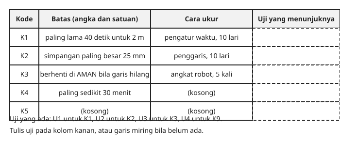

**Ingat dulu:** Tanpa melihat catatan, jawab. (1) Sebut tiga lapis yang diperiksa pada ulasan keamanan. ______ (2) Bagian apa saja pada catatan optimasi yang membuat orang lain dapat menilai keputusanmu? ______

`[Gambar: tabel lima kebutuhan K1 sampai K5 dengan batas dan cara ukur (K4 tanpa cara ukur, K5 tanpa batas dan cara ukur), kolom kosong uji yang menunjuknya, dan daftar uji U1 untuk K1, U2 untuk K2, U3 untuk K3, U4 untuk K9.]`

**Prediksi:** Tebak dulu, tulis jawabanmu. Dari tabel pada gambar, periksa satu per satu: kebutuhan tanpa batas terukur, tanpa cara ukur, atau tanpa uji, dan uji yang menunjuk kebutuhan yang tidak ada. Berapa masalah kamu temukan seluruhnya? ______ Tulis semuanya: ______

**Latihan:**

1. `AI: tanpa AI` Tulis ulang K5 ("tanpa data pribadi") agar punya batas yang dapat gagal dan cara ukur. ______
2. `AI: tanpa AI` Tulis tiga sampai lima kebutuhan proyek rancanganmu dengan angka, satuan, dan cara ukur, lalu satu uji untuk tiap kebutuhan. ______
3. `AI: tanpa AI` Tulis kriteria selesai, prediksi hasil, dan daftar fitur yang boleh dipotong lebih dulu. ______
4. `AI: boleh` Dari `c-xii2-m3`: tujuan pada lembar pemodelan menjadi bagian mana dari dokumen rancangan, dan mengapa ia harus dapat gagal? ______

**Cek diri:**

- [ ] Tiap kebutuhanku punya angka, satuan, cara ukur, dan uji.
- [ ] Tiap ujiku menunjuk kebutuhan yang ada.
- [ ] Prediksiku ditulis sebelum mengerjakan.

**Catatan cetak (untuk guru, tidak dicetak):** satu halaman A4. Kunci ada di modul `c-xii2-m5` bagian "Kunci dan petunjuk". Lembar tidak memuat kolom identitas.
