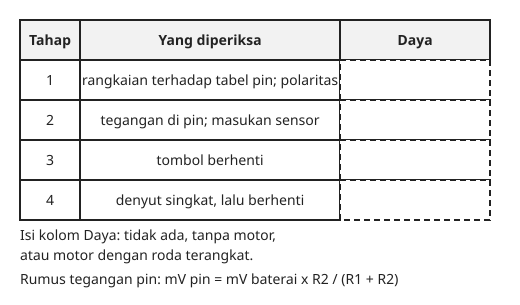

**Ingat dulu:** Tanpa melihat catatan, jawab. (1) Mengapa tiap kebutuhan harus punya uji yang menunjuknya? ______ (2) Mengapa dokumen perlu nomor versi dan riwayat perubahan? ______

`[Gambar: tabel empat tahap uji (rangkaian terhadap tabel pin, tegangan di pin dan masukan sensor, tombol berhenti, denyut singkat lalu berhenti) dengan kolom daya kosong, dan rumus tegangan pin pembagi tegangan di bawahnya.]`

**Prediksi:** Tebak dulu, tulis jawabanmu, baru hitung. Empat sel AA, tiap sel 1600 mV (sel baru tanpa beban). Batas contoh pada pin papan 3,3 V adalah 3100 mV. Hitung dengan rumus pada gambar (kalikan dulu, baru bagi).

| Rangkaian | R1 | R2 | mV di pin | AMAN disambung? |
| --- | --- | --- | --- | --- |
| pembagi A | 20000 | 10000 | ______ | ______ |
| pembagi B | 10000 | 10000 | ______ | ______ |

**Latihan:**

1. `AI: tanpa AI` Hitung tegangan di pin untuk rangkaian proyekmu dengan baterai terbaru. Apakah di bawah batas pin papanmu? ______
2. `AI: boleh` Tulis tabel pin dari daftar pin bernama yang sama dengan program. Apakah ada pin kembar? ______
3. `AI: tanpa AI` Isi lembar uji tahap 1 sampai 3: tanggal, prediksi, hasil. ______
4. `AI: boleh` Dari `C-XII1-M10`: mengapa baterai tidak pernah langsung ke pin, dan apa yang melindungi pin? ______

**Cek diri:**

- [ ] Saya menghitung tegangan di pin sebelum menyambung baterai.
- [ ] Saya menguji bertahap dan mencatat tiap tahap.
- [ ] Tombol berhenti saya uji sebelum motor menyala di lintasan.

**Catatan cetak (untuk guru, tidak dicetak):** satu halaman A4. Kunci ada di modul `c-xii2-m6` bagian "Kunci dan petunjuk". Lembar tidak memuat kolom identitas.
