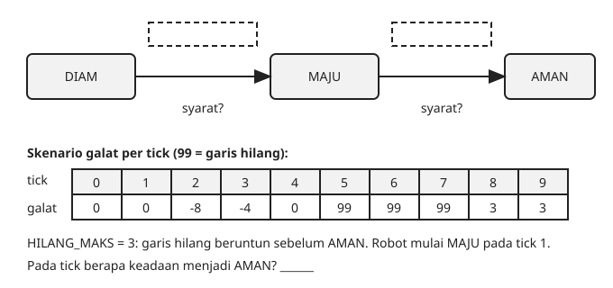

**Ingat dulu:** Tanpa melihat catatan, jawab. Berapa byte yang dipakai satu catatan log berisi `uint16_t`, `uint8_t`, dan `int8_t`, dan berapa untuk enam catatan? ______ (Dari `c-xii2-m2`.)

`[Gambar: tiga kotak keadaan DIAM, MAJU, AMAN dengan dua panah dan dua kotak syarat kosong; di bawahnya deret sepuluh tick (0 sampai 9) dengan galat 0, 0, -8, -4, 0, 99, 99, 99, 3, 3 (99 berarti garis hilang), dan HILANG_MAKS = 3.]`

**Prediksi:** Tebak dulu, tulis jawabanmu, baru telusuri. Robot mulai MAJU pada tick 1 dan masuk AMAN bila garis hilang tiga tick beruntun. Pada skenario di gambar:

1. Pada tick berapa garis hilang pertama kali? ______ Pada tick berapa robot masuk AMAN? ______
2. Selama garis hilang tetapi belum AMAN, roda memakai perintah apa? ______
3. Tulis syarat peralihan DIAM ke MAJU dan MAJU ke AMAN pada kotak di gambar.

**Latihan:**

1. `AI: tanpa AI` Tulis tiga skenario perangkat tiruan: normal, garis hilang sebentar lalu kembali, garis hilang terus. Tulis prediksi keadaan akhir tiap skenario sebelum menjalankan. ______
2. `AI: boleh` Tulis daftar fungsi `Perangkat` untuk proyekmu (masukan, keluaran, tombol). Adakah pemanggilan perangkat keras di luar kelas yang mengisinya? ______
3. `AI: boleh` Dari `c-xii2-m6`: bila pin motor berganti, bagian mana dari program inti berubah dan bagian mana tidak? ______

**Cek diri:**

- [ ] Logika saya tidak memanggil perangkat keras langsung.
- [ ] Keadaan `AMAN` mematikan roda dan hanya manusia yang mengeluarkan robot darinya.
- [ ] Prediksi saya ditulis sebelum menjalankan.

**Catatan cetak (untuk guru, tidak dicetak):** satu halaman A4. Kunci ada di modul `c-xii2-m7` bagian "Kunci dan petunjuk". Lembar tidak memuat kolom identitas.
