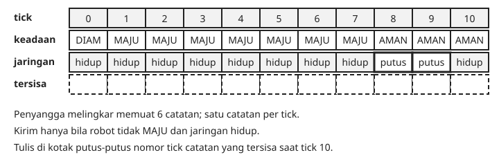

**Ingat dulu:** Tanpa melihat catatan, jawab. (1) Mengapa logika keputusan dipisahkan dari perangkat lewat antarmuka? ______ (2) Kapan data dari sensor yang tampak biasa menjadi data pribadi? ______

`[Gambar: sebelas tick bernomor 0 sampai 10. Keadaan: DIAM pada tick 0, MAJU pada tick 1 sampai 7, AMAN pada tick 8 sampai 10. Jaringan putus pada tick 8 dan 9, hidup pada tick lain. Baris paling bawah berisi sebelas kotak kosong untuk catatan yang tersisa di penyangga.]`

**Prediksi:** Tebak dulu, tulis jawabanmu, baru telusuri. Penyangga melingkar memuat enam catatan, satu catatan per tick, dan catatan terbaru menimpa yang tertua bila penuh. Pengiriman hanya terjadi bila robot tidak `MAJU` dan jaringan hidup. Pada tick 0 pengiriman berhasil. Berdasarkan gambar:

1. Berapa catatan tertimpa saat pengiriman berhasil kedua (tick 10)? ______
2. Catatan tick berapa yang tertua dan masih tersisa pada saat itu? ______
3. Mengapa pengiriman tidak dilakukan saat `MAJU`? ______

**Latihan:**

1. `AI: tanpa AI` Tulis prediksi jumlah catatan tertimpa untuk skenario karanganmu sendiri (kapasitas dan tick jaringan putus kamu pilih) sebelum menjalankan. ______
2. `AI: boleh` Pilih kolom log dan hitung byte seluruh penyangga. Apakah ada kolom pengenal? ______
3. `AI: tanpa AI` Uji jaringan mati tanpa papan: ubah `jaringanHidup` agar selalu `false`. Tulis prediksi keluarannya dulu. ______
4. `AI: boleh` Dari `c-xii2-m6`: apa yang kamu catat pada lembar uji "jaringan mati"? ______

**Cek diri:**

- [ ] Robotku tetap `AMAN` bila jaringan mati.
- [ ] Pengiriman hanya saat robot tidak `MAJU`.
- [ ] Data tanpa pengenal; rahasia di luar repositori.

**Catatan cetak (untuk guru, tidak dicetak):** satu halaman A4. Kunci ada di modul `c-xii2-m8` bagian "Kunci dan petunjuk". Lembar tidak memuat kolom identitas.
