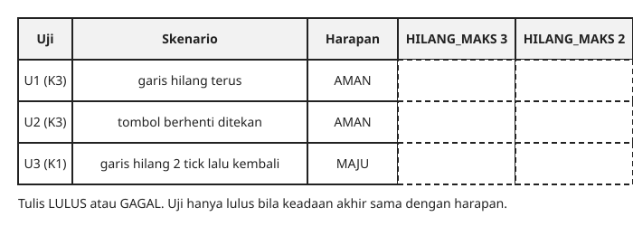

**Ingat dulu:** Tanpa melihat catatan, jawab. (1) Mengapa pengiriman data lewat jaringan tidak dilakukan saat robot `MAJU`? ______ (2) Sebut tiga bau kode dan satu perbaikan untuk masing-masing. ______

`[Gambar: tabel tiga uji (U1 garis hilang terus, harapan AMAN; U2 tombol berhenti ditekan, harapan AMAN; U3 garis hilang 2 tick lalu kembali, harapan MAJU) dengan kolom kosong hasil untuk HILANG_MAKS 3 dan HILANG_MAKS 2.]`

**Prediksi:** Tebak dulu, tulis jawabanmu, baru telusuri. Kebutuhan K3 menuntut berhenti secepat mungkin saat garis hilang, jadi seseorang menurunkan `HILANG_MAKS` dari 3 menjadi 2 (garis hilang beruntun sebelum robot masuk AMAN). Isi kolom hasil pada gambar dengan LULUS atau GAGAL. Uji mana yang gagal? ______ Mengapa kebutuhan K3 yang diperbaiki justru merusak kebutuhan lain? ______

**Latihan:**

1. `AI: tanpa AI` Tulis satu uji tiruan per kebutuhan yang dapat diuji tanpa papan, dengan id kebutuhannya. Tulis prediksi sebelum menjalankan. ______
2. `AI: tanpa AI` Ubah satu konstanta, jalankan semua uji, catat sebelum dan sesudah. Apa yang dimuat lembar uji? ______
3. `AI: boleh` Dari `c-xii2-m7`: dengan `HILANG_MAKS` 4, berapa uji di atas yang gagal, dan apa yang tidak tertangkap? ______
4. `AI: boleh` Dari `c-xii2-m8`: kapasitas log dinaikkan dari 6 ke 12. Uji regresi apa yang kamu tambahkan? ______

**Cek diri:**

- [ ] Aku mengubah satu hal lalu menjalankan semua uji.
- [ ] Catatan rilisku memuat yang belum beres.
- [ ] Prediksiku ditulis sebelum menjalankan.

**Catatan cetak (untuk guru, tidak dicetak):** satu halaman A4. Kunci ada di modul `c-xii2-m9` bagian "Kunci dan petunjuk". Lembar tidak memuat kolom identitas.
