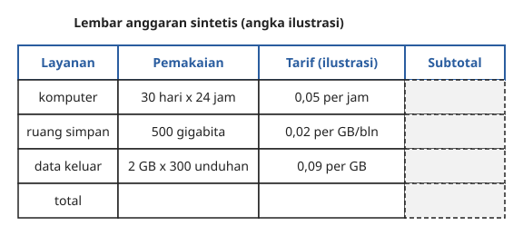

**Ingat dulu:** Tanpa melihat catatan: (1) Apa arti ciri "terukur" pada cloud? (2) Mengapa data dan akun selalu menjadi bagian pengguna pada model tanggung jawab bersama? (3) Sebutkan dua hal yang tidak boleh ditempel di kode, layar, atau pesan.

1. ______
2. ______
3. ______

`[Gambar: tabel empat kolom (Layanan, Pemakaian, Tarif ilustrasi, Subtotal) dengan tiga layanan karangan: komputer virtual 30 hari 24 jam bertarif 0,05 dolar per jam, ruang simpan 500 gigabita bertarif 0,02 dolar per gigabita per bulan, dan data keluar 2 gigabita diunduh 300 kali bertarif 0,09 dolar per gigabita. Kolom subtotal dan baris total kosong. Semua angka ilustrasi, bukan harga nyata.]`

**Prediksi:** Sebelum menghitung, tebak tagihan satu bulan komputer yang dibiarkan menyala terus: ______ dolar. Setelah menghitung, selisihnya: ______

**Lengkapi:** Soal fiktif: komputer virtual 0,10 dolar per jam menyala 8 jam; ruang simpan 20 gigabita bertarif 0,02 dolar per gigabita per bulan.

1. Komputer: ___ x ___ = ______ dolar.
2. Ruang: ___ x ___ = ______ dolar per bulan.
3. Total: ______ + ______ = ______ dolar.

**Latihan:** (semua angka ilustrasi)

1. Komputer 0,05 dolar per jam menyala 30 hari, 24 jam sehari. Berapa tagihannya? Berapa bila dimatikan setelah 3 jam latihan? ______
2. Klub menyimpan 500 gigabita foto bertarif 0,02 dolar per gigabita per bulan. Berapa per bulan dan per tahun? ______
3. Video 2 gigabita diunduh 300 kali, tarif data keluar 0,09 dolar per gigabita. Berapa biayanya? ______
4. Tuliskan lima langkah yang dilakukan pemilik akun fiktif begitu menyadari kunci akses terunggah ke repositori publik. ______

**Cek diri:**

- [ ] Saya dapat membaca model tarif dan memperkirakan biaya dari angka ilustrasi.
- [ ] Saya dapat mengenali jebakan tagihan dan menjelaskan fungsi anggaran dan peringatan.

**Catatan cetak (untuk guru, tidak dicetak):** satu halaman A4. Kunci ada di modul `cloud-biaya-dan-tagihan` bagian "Latihan" (petunjuk jawaban ada sesudah tiap latihan). Lembar tidak memuat kolom identitas.
