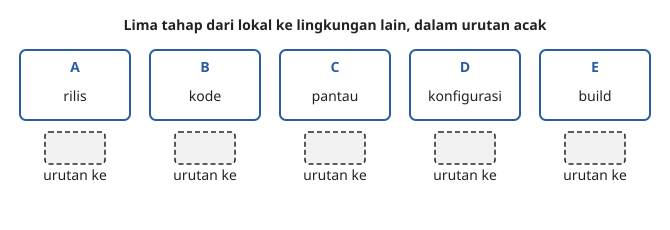

**Ingat dulu:** Tanpa melihat catatan: (1) Apa yang dilakukan `Bun.serve` pada program server sederhana? (2) Mengapa rahasia tidak boleh di-commit ke repositori? (3) Sebutkan dua jebakan tagihan cloud.

1. ______
2. ______
3. ______



`[Gambar: lima kartu berlabel A sampai E dalam urutan acak: A rilis, B kode, C pantau, D konfigurasi, E build. Di bawah tiap kartu ada kotak kosong "urutan ke" untuk ditulis nomor 1 sampai 5.]`

**Prediksi:** Baca `server.ts` di bawah. Apa yang tampil di peramban (1) bila `PESAN_SAMBUTAN` tidak diatur? ______ (2) bila diatur "Halo dari lingkungan contoh"? ______ (3) bila ada berkas `.env` berisi `PESAN_SAMBUTAN=Halo dari berkas` di folder yang sama? ______

**Lengkapi:**

```ts setengah-jadi
const pesan = process.env.______ ?? "pesan bawaan";

Bun.serve({
  port: 3000,
  fetch() {
    return new ______(pesan);
  },
});
console.log("Server lokal berjalan di port 3000");
```

**Susun:** Beri nomor urutan yang benar pada kartu di gambar (1 sampai 5). Urutan huruf: ______

**Latihan:**

1. Tulis tiga perbedaan lingkungan lokal dan produksi. ______
2. Pada potongan repositori fiktif ada `<KUNCI-RAHASIA-CONTOH>` di berkas sumber. Bagaimana kamu memindahkannya, dan berkas apa yang diubah? ______
3. Jalankan server lokal dengan dua nilai `PESAN_SAMBUTAN` berbeda. Apa yang berubah tanpa mengubah kode? ______
4. Tim Contoh menaruh `KUNCI_RAHASIA` asli di kode, meng-commit-nya ke repositori publik, dan menjalankan demonstrasi tanpa anggaran. Tulis semua kelalaiannya dan kelompokkan: kode lawan konfigurasi, rahasia, biaya, privasi AI. ______

**Cek diri:**

- [ ] Saya dapat membedakan lokal dan produksi.
- [ ] Saya dapat memakai variabel lingkungan tanpa menaruh rahasia di kode.

**Catatan cetak (untuk guru, tidak dicetak):** satu halaman A4. Petunjuk jawaban ada sesudah tiap latihan di modul `cloud-deploy-sederhana` bagian "Latihan" dan "Latihan bercampur". Lembar tidak memuat kolom identitas.
