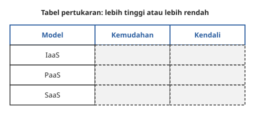

**Ingat dulu:** Tanpa melihat catatan: (1) Sebutkan lima ciri cloud menurut NIST. (2) Apa tugas sistem operasi pada sebuah komputer?

1. ______
2. ______

`[Gambar: tabel tiga baris (IaaS, PaaS, SaaS) dengan kolom Kemudahan dan Kendali yang kosong. Isi tiap sel dengan "lebih tinggi" atau "lebih rendah".]`

**Prediksi:** Naik dari IaaS ke SaaS, apa yang kamu korbankan? ______

**Lengkapi:** Isi tabel pembagian tugas.

| Model | Kamu mengurus | Penyedia mengurus |
| --- | --- | --- |
| IaaS | | |
| PaaS | | |
| SaaS | | |

**Susun:** Urutkan tiga pertanyaan "Memilih model" dari yang diajukan pertama sampai ketiga. Urutan huruf: ______

- A. Butuh kendali penuh atas sistem operasi dan pengaturan?
- B. Sudah ada aplikasi jadi yang cukup?
- C. Membuat aplikasi sendiri tetapi tidak ingin mengurus server?

**Latihan:**

1. Golongkan: (a) OSIS ingin lembar kerja daring bersama; (b) klub ingin menjalankan program buatan sendiri di server tanpa mengurus sistem operasi; (c) tim ingin memasang sistem operasi pilihan dan membuat pengaturan jaringan sendiri. ______
2. Untuk tiap kasus, tulis model dan satu ciri cloud yang tampak: (a) klub fotografi menambah ruang simpan lewat tombol, tagihan dihitung dari ruang yang dipakai; (b) tim menyewa komputer virtual dan memasang sistem operasi sendiri; (c) sekolah memakai aplikasi absensi yang dipakai ratusan sekolah lain. ______
3. Tulis satu risiko SaaS dan satu risiko mengurus server sendiri. ______

**Cek diri:**

- [ ] Saya dapat membedakan IaaS, PaaS, dan SaaS serta memberi contoh masing-masing.
- [ ] Saya dapat memilih model yang pantas untuk sebuah kebutuhan.

**Catatan cetak (untuk guru, tidak dicetak):** satu halaman A4. Petunjuk jawaban ada sesudah tiap latihan di modul `cloud-iaas-paas-saas` bagian "Latihan" dan "Latihan bercampur". Lembar tidak memuat kolom identitas.
