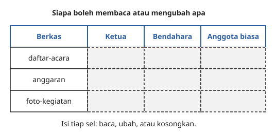

**Ingat dulu:** Tanpa melihat catatan: (1) Apa bagian yang selalu menjadi tanggung jawab pengguna pada model tanggung jawab bersama? (2) Apa fungsi autentikasi dua langkah? (3) Apa bahayanya satu kata sandi yang sama untuk semua layanan?

1. ______
2. ______
3. ______

`[Gambar: tabel tiga baris berkas (daftar-acara, anggaran, foto-kegiatan) dan tiga kolom peran (ketua, bendahara, anggota biasa). Semua sel kosong: isi dengan baca, ubah, atau biarkan kosong, menurut prinsip hak akses minimum.]`

**Prediksi:** Klub fiktif menyimpan daftar anggota (nama dan nomor ponsel karangan) di penyimpanan daring, folder dibagikan ke "siapa saja yang punya tautan", dan tidak ada cadangan. Kelalaian mana yang menurutmu paling mendesak diperbaiki? ______

**Lengkapi:** Isi kolom dampak dan perbaikan.

| Kartu | Dampak | Perbaikan |
| --- | --- | --- |
| kunci ditempel di grup pesan | | |
| folder dibagikan ke publik | | |
| tidak ada log | | |
| tidak ada cadangan | | |

**Susun:** Urutkan tiga perbaikan menurut yang paling mendesak. Urutan huruf: ______

- A. Buat cadangan terpisah
- B. Cabut dan putar kunci akses
- C. Ubah izin folder, pakai kata sandi unik, dan nyalakan autentikasi dua langkah

**Latihan:**

1. Nilai kekuatan tiap kata sandi karangan dan alasannya: "123456", "kelas11ipa", "k7#Rp9!vQ2mLw4". ______
2. Dengan kata-katamu sendiri, jelaskan dalam tiga kalimat perbedaan fokus ISO/IEC 27017 dan 27018. ______
3. Sekolah fiktif ingin mengunggah nilai siswa beserta nama asli ke layanan daring gratis. Tulis tiga pertanyaan yang perlu dijawab sebelum setuju dan siapa yang berhak memutuskan. ______

**Cek diri:**

- [ ] Saya dapat menerapkan prinsip keamanan dasar untuk data di cloud.
- [ ] Saya dapat menjelaskan apa itu data pribadi dan mengapa penanganannya khusus.

**Catatan cetak (untuk guru, tidak dicetak):** satu halaman A4. Petunjuk jawaban ada sesudah tiap latihan di modul `cloud-keamanan-dan-privasi` bagian "Latihan" dan "Latihan bercampur". Lembar tidak memuat kolom identitas.
