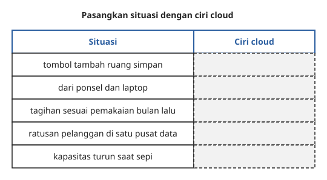

**Ingat dulu:** Tanpa melihat catatan: (1) Apa tugas klien dan apa tugas server? (2) Apa yang dilakukan DNS ketika kamu mengetik nama situs? (3) Mengapa data dikirim dalam potongan yang disebut paket?

1. ______
2. ______
3. ______

`[Gambar: tabel dua kolom, Situasi dan Ciri cloud. Lima situasi: tombol tambah ruang simpan; dari ponsel dan laptop; tagihan sesuai pemakaian bulan lalu; ratusan pelanggan di satu pusat data; kapasitas turun saat sepi. Kolom ciri kosong: tulis salah satu dari lima ciri cloud untuk tiap situasi.]`

**Prediksi:** Pada permainan peran satu permintaan, server dipindah ke "pusat data" di kota lain. Apa yang berubah bagi klien? ______

**Lengkapi:** Isi tabel lima ciri cloud menurut NIST.

| Ciri | Artinya dalam bahasa sehari-hari |
| --- | --- |
| | Kamu menyediakan sendiri sumber daya lewat layar, tanpa menelepon petugas |
| | Bisa dipakai dari berbagai perangkat lewat internet |
| | Penyedia melayani banyak pelanggan dari kumpulan sumber daya yang sama |
| | Kapasitas bisa naik atau turun mengikuti kebutuhan |
| | Pemakaian dihitung, dan biasanya itulah dasar tagihan |

**Susun:** Urutkan satu permintaan halaman "halaman-kelas.contoh". Urutan huruf: ______

- A. Server mengembalikan halaman
- B. Klien meminta alamat
- C. Klien meminta halaman ke alamat itu
- D. Pencari alamat (DNS) memberi alamat

**Latihan:**

1. Tulis "cloud cocok", "kurang cocok", atau "tergantung" beserta satu alasan: (a) situs pengumuman kelulusan yang ramai dua hari per tahun; (b) daftar nilai siswa yang berisi nama asli; (c) latihan kelompok yang mengedit dokumen bersama. ______
2. Tulis tiga kalimat: apa itu cloud, satu manfaat, satu risiko. ______
3. Beri satu kasus saat cloud cocok dan satu saat kurang cocok, dengan alasan. ______

**Cek diri:**

- [ ] Saya dapat menjelaskan apa itu cloud computing dengan kata-kata sendiri dan menyebut ciri-cirinya.
- [ ] Saya dapat menilai kapan cloud cocok dan kapan tidak.

**Catatan cetak (untuk guru, tidak dicetak):** satu halaman A4. Petunjuk jawaban ada sesudah tiap latihan di modul `cloud-konsep-dasar` bagian "Latihan". Lembar tidak memuat kolom identitas.
