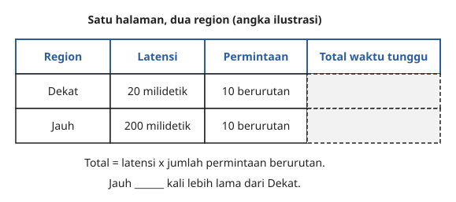

**Ingat dulu:** Tanpa melihat catatan: (1) Apa beda IaaS, PaaS, dan SaaS dalam satu kalimat? (2) Apa fungsi alamat IP dan apa fungsi DNS? (3) Mengapa membuka situs yang servernya jauh bisa terasa lebih lambat?

1. ______
2. ______
3. ______

`[Gambar: tabel dua baris. Region Dekat berlatensi 20 milidetik dan region Jauh berlatensi 200 milidetik, masing-masing 10 permintaan berurutan untuk satu halaman. Kolom total waktu tunggu kosong, dan ada isian "Jauh ___ kali lebih lama dari Dekat". Semua angka ilustrasi, bukan data nyata.]`

**Prediksi:** Sebelum menghitung, tebak: berapa kali lebih lama waktu tunggu region jauh dibanding region dekat? ______ Selisih tebakan dan hasil hitunganmu: ______

**Lengkapi:** Soal fiktif: Dekat (20 milidetik, satu zona) dan Jauh (200 milidetik, dua zona); satu halaman butuh 4 permintaan berurutan.

1. Waktu tunggu Dekat: ___ x ___ = ______ milidetik. Jauh: ___ x ___ = ______ milidetik.
2. Bila satu zona padam, situs di Dekat ______ dan situs di Jauh ______.
3. Situs perpustakaan sekolah tidak kritis dan tidak memuat data pribadi. Pilihanku: ______ karena ______.

**Susun:** Urutkan empat hal yang dipengaruhi pilihan region menurut modul, mulai yang disebut pertama. Urutan huruf: ______

- A. Biaya
- B. Latensi
- C. Lokasi data
- D. Ketersediaan

**Latihan:**

1. Satu zona "padam". Layanan A hanya ada di zona itu, layanan B ada di dua zona. Apa yang dialami pengguna masing-masing? ______
2. Tulis dua pertanyaan yang perlu dijawab sebelum menaruh data pribadi di region luar negeri. ______
3. Sekolah Contoh menaruh situs pengumuman kelulusan (ramai dua hari setahun) dan daftar nilai berisi nama siswa. Untuk tiap bagian, pilih model layanan dan region (atau tidak di cloud), beri alasan. ______

**Cek diri:**

- [ ] Saya dapat membedakan region dan zona ketersediaan.
- [ ] Saya dapat menyebut hal yang dipengaruhi pilihan region.

**Catatan cetak (untuk guru, tidak dicetak):** satu halaman A4. Petunjuk jawaban ada sesudah tiap latihan di modul `cloud-layanan-dan-region` bagian "Latihan" dan "Latihan bercampur". Lembar tidak memuat kolom identitas.
