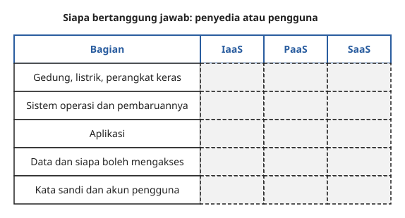

**Ingat dulu:** Tanpa melihat catatan: (1) Sebutkan tiga model layanan cloud dan satu hal yang kamu urus sendiri pada masing-masing. (2) Apa itu autentikasi dua langkah dan mengapa kata sandi saja tidak cukup? (3) Apa arti hak akses minimum?

1. ______
2. ______
3. ______

`[Gambar: tabel lima baris bagian (gedung, listrik, perangkat keras; sistem operasi dan pembaruannya; aplikasi; data dan siapa yang boleh mengaksesnya; kata sandi dan akun pengguna) dan tiga kolom IaaS, PaaS, SaaS. Semua sel kosong: tulis "penyedia" atau "pengguna".]`

**Prediksi:** Isi tabel di gambar dari tebakanmu, lalu cocokkan dengan modul dan lingkari yang meleset. Baris mana yang menurutmu sama untuk semua model? ______

**Lengkapi:** Tiap kasus fiktif memuat satu kelalaian. Isi model layanan, pihak yang bertanggung jawab, dan satu langkah perbaikan.

| Kasus | Model | Pihak | Perbaikan |
| --- | --- | --- | --- |
| Admin klub tidak memasang pembaruan sistem operasi pada komputer virtual sewaan | | | |
| Pengelola aplikasi absensi daring memakai kata sandi "admin123" | | | |
| Klub menyimpan kunci akses di kode yang diunggah ke repositori publik (platform yang mengurus server) | | | |

**Susun:** Urutkan lima pertanyaan daftar periksa "apa bagian saya" menurut urutan di modul. Urutan huruf: ______

- A. Apakah ada yang menjalankan pembaruan?
- B. Siapa yang boleh membuka data ini?
- C. Siapa yang kuhubungi bila ada kejadian?
- D. Apakah akun dilindungi kata sandi kuat dan autentikasi dua langkah?
- E. Apakah ada data yang seharusnya tidak berada di sini sama sekali?

**Latihan:**

1. Klub fiktif "Robotik Contoh" mengatur akses daftar anggota ke "publik" agar mudah diunduh, dan seminggu kemudian daftar itu ditemukan di forum. Tulis (a) penyebab, (b) siapa yang bertanggung jawab atas pengaturan itu, (c) tiga langkah pencegahan. ______
2. Tulis penyedia atau pengguna: "disk server rusak"; "kata sandi akun ditebak karena 123456"; "gedung pusat data kebanjiran"; "aplikasi punya celah yang belum ditambal (pada IaaS)". ______
3. Pilih satu layanan daring yang kamu pakai dan jawab lima pertanyaan daftar periksa, tanpa menuliskan kata sandi atau data pribadi. ______

**Cek diri:**

- [ ] Saya dapat menjelaskan keamanan "of the cloud" dan "in the cloud" dengan kata-kataku.
- [ ] Saya dapat menjelaskan mengapa data dan akun selalu menjadi bagian pengguna.

**Catatan cetak (untuk guru, tidak dicetak):** satu halaman A4. Petunjuk jawaban ada sesudah tiap latihan di modul `cloud-tanggung-jawab-bersama` bagian "Latihan" dan "Latihan bercampur". Lembar tidak memuat kolom identitas.
