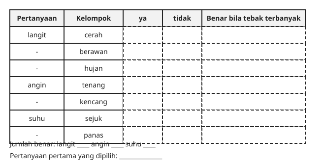

**Ingat dulu:** Tanpa melihat catatan, jawab. (1) Apa itu fitur dan apa itu label? Beri contoh. ______ (2) Pada lembar kerja, nilai ada di sel `B2` sampai `B6`. Tulis rumus rata-ratanya. ______



`[Gambar: tabel tujuh baris untuk tiga pertanyaan (langit: cerah, berawan, hujan; angin: tenang, kencang; suhu: sejuk, panas) dengan kolom ya, tidak, dan benar bila tebak terbanyak yang kosong, serta tempat menulis jumlah benar tiap pertanyaan dan pertanyaan pertama yang dipilih.]`

**Prediksi:** Empat belas **kartu latih** karangan: apakah lapangan sekolah dipakai (`ya`) atau tidak (`tidak`).

| No | Langit | Angin | Suhu | Dipakai |
| --- | --- | --- | --- | --- |
| 1 | cerah | tenang | sejuk | ya |
| 2 | cerah | kencang | sejuk | ya |
| 3 | cerah | tenang | panas | tidak |
| 4 | cerah | kencang | panas | tidak |
| 5 | berawan | tenang | sejuk | ya |
| 6 | berawan | kencang | panas | ya |
| 7 | berawan | tenang | panas | ya |
| 8 | berawan | kencang | sejuk | ya |
| 9 | hujan | tenang | sejuk | tidak |
| 10 | hujan | kencang | sejuk | tidak |
| 11 | hujan | tenang | panas | tidak |
| 12 | hujan | kencang | panas | tidak |
| 13 | cerah | tenang | sejuk | ya |
| 14 | berawan | tenang | sejuk | ya |

Sebelum menghitung, tebak: pertanyaan mana (langit, angin, atau suhu) yang paling banyak memisahkan `ya` dari `tidak`? ______ Alasan: ______ Lalu hitung dan isi tabel pada gambar.

**Lengkapi:** Aturan sederhana: "bila hujan, `tidak`; selain itu `ya`". Kartu uji (kartu yang tidak dipakai membuat aturan): (1) cerah, kencang, sejuk, ya; (2) cerah, tenang, panas, tidak; (3) berawan, kencang, panas, ya; (4) hujan, tenang, sejuk, tidak; (5) berawan, tenang, panas, tidak; (6) hujan, kencang, panas, ya.

1. Pada kartu latih, aturan ini salah pada kartu nomor ____ dan ____, jadi benar pada ____ dari 14.
2. Pada kartu uji, aturan ini benar pada kartu nomor ____, ____, dan ____, jadi benar pada ____ dari 6.

**Susun:** Urutkan langkah A sampai E untuk membuat dan menguji pohon keputusan.

```text
(A) uji pohon pada kartu uji dan hitung ketepatan
(B) pilih pertanyaan terbaik sebagai akar dan pisahkan kartu
(C) hitung, untuk tiap pertanyaan, kartu yang benar bila tiap kelompok menebak label terbanyak
(D) ulangi pada kelompok yang masih campur
(E) tulis label terbanyak pada tiap ujung yang murni
```

Urutanku: ______

**Latihan:**

1. `AI: tanpa AI` Delapan kartu tanaman karangan (daun, tinggi, label): (lebar, pendek, A), (lebar, tinggi, A), (sempit, pendek, B), (sempit, tinggi, B), (lebar, pendek, A), (sempit, pendek, B), (lebar, tinggi, A), (sempit, tinggi, B). Hitung kartu yang benar untuk pertanyaan daun dan pertanyaan tinggi, pilih yang terbaik, dan tulis ketepatannya. ______
2. `AI: boleh` Mengapa ketepatan 100 persen pada kartu latih belum membuktikan apa-apa? ______
3. `AI: boleh` Pohon keputusan di modul ini dibuat tangan dari contoh. Apakah ia "aturan tulisan manusia" atau "sistem yang belajar dari data"? Mengapa jawabannya tidak sepenuhnya salah satu? ______

**Cek diri:**

- [ ] Saya dapat memilih pertanyaan terbaik dengan menghitung kartu yang benar.
- [ ] Saya dapat menghitung ketepatan pada kartu latih dan kartu uji.
- [ ] Saya dapat menjelaskan mengapa uji harus memakai kartu yang belum dilihat.

**Catatan cetak (untuk guru, tidak dicetak):** dua halaman A4. Kunci ada di modul `d-x1-m10` bagian "Kunci dan petunjuk". Lembar tidak memuat kolom identitas.
