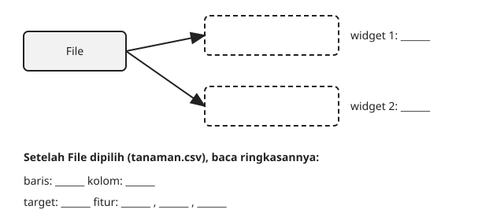

**Ingat dulu:** Tanpa melihat catatan, jawab. (1) Bagaimana menghitung ketepatan (akurasi) sebuah aturan? ______ (2) Ubah 200 ke biner 8 bit. ______



`[Gambar: kotak File di kiri dengan dua panah ke dua kotak kosong untuk nama widget yang kamu pilih. Di bawahnya tempat menulis jumlah baris, jumlah kolom, target, dan fitur dari ringkasan File.]`

**Prediksi:** Dataset karangan `tanaman.csv`: 30 tanaman fiktif, fitur `air_ml`, `sinar_jam`, `pot`, dan label `kondisi` (`segar` atau `layu`). Awalan `c#` pada nama kolom terakhir memberi tahu Orange bahwa kolom itu adalah kelas (target).

```text
air_ml,sinar_jam,pot,c#kondisi
220,3,besar,layu
80,5,kecil,segar
160,8,kecil,segar
170,5,besar,segar
110,2,kecil,layu
140,3,sedang,layu
300,1,kecil,layu
230,3,besar,segar
70,8,sedang,layu
140,5,besar,segar
70,7,besar,layu
220,2,sedang,layu
260,3,besar,layu
250,4,besar,segar
270,2,besar,layu
200,6,kecil,segar
260,7,kecil,segar
250,1,sedang,layu
230,2,sedang,segar
50,3,kecil,layu
300,1,kecil,segar
360,4,kecil,layu
120,7,sedang,segar
300,3,kecil,layu
40,6,kecil,layu
130,8,kecil,segar
130,3,besar,layu
320,8,besar,layu
60,6,sedang,layu
240,8,sedang,segar
```

Sebelum membuka apa pun, lihat sepuluh baris pertama dan tebak: faktor mana yang paling berkaitan dengan `segar`: air, sinar, atau pot? ______ Alasan: ______

**Lengkapi:** Gunakan tabel `tanaman.csv`.

1. Dari 30 baris, ____ berlabel `segar`; jadi aturan "selalu tebak `layu`" benar pada ____ dari 30.
2. Kolom bertipe kategori: ____; kolom bertipe angka: ____ dan ____.
3. Di File, peran kolom `kondisi` adalah ____ dan tiga kolom lain berperan sebagai ____.

**Susun:** Urutkan langkah A sampai E untuk melihat data di Orange.

```text
(A) sambungkan File ke Data Table dan periksa jumlah baris dan kolom
(B) simpan tabel sebagai tanaman.csv
(C) taruh widget File di kanvas Orange
(D) sambungkan File ke Scatter Plot dan warnai titik menurut kondisi
(E) pilih tanaman.csv di File dan periksa peran tiap kolom
```

Urutanku: ______

**Latihan:**

1. `AI: tanpa AI` Berapa baris dengan `air_ml` 250 atau lebih? Dari baris itu, berapa yang `segar`? Berapa baris pot `besar` yang `layu`? ______
2. `AI: tanpa AI` Cari dua baris yang fiturnya sama persis tetapi labelnya berbeda. Mengapa pasangan seperti itu menyulitkan model? ______
3. `AI: boleh` Tulis tiga pertanyaan yang dapat dijawab diagram sebar dan satu pertanyaan yang tidak dapat dijawabnya. ______

**Cek diri:**

- [ ] Saya dapat membaca jumlah baris dan kolom dan membedakan fitur dari target.
- [ ] Saya dapat menyatakan dugaan pola dan batasnya.
- [ ] Saya memeriksa data sebelum melatih model.

**Catatan cetak (untuk guru, tidak dicetak):** dua halaman A4. Kunci ada di modul `d-x1-m11` bagian "Kunci dan petunjuk". Lembar tidak memuat kolom identitas.
