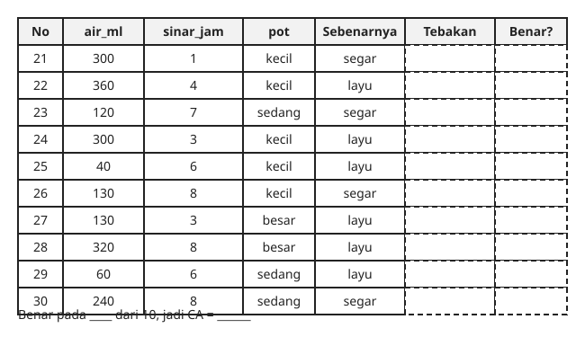

**Ingat dulu:** Tanpa melihat catatan, jawab. (1) Bagaimana memuat berkas CSV di Orange dan memastikan kolom label berperan sebagai target? ______ (2) Sebutkan empat jenis masalah kualitas data. ______



`[Gambar: tabel sepuluh baris data uji tanaman bernomor 21 sampai 30 dengan kolom air_ml, sinar_jam, pot, dan kondisi sebenarnya terisi; kolom tebakan dan benar kosong, serta tempat menulis jumlah benar dan CA.]`

**Prediksi:** Kamu melatih pohon keputusan pada 20 baris pertama `tanaman.csv` (data latih) dan mengujinya pada 10 baris terakhir (data uji, pada gambar). Sebelum menjalankan apa pun, tulis: (1) ketepatan pohon pada data latih ______ (2) ketepatan pada data uji ______ (3) mana yang lebih tinggi, dan mengapa? ______

**Lengkapi:** Pohon hasil latih, dibaca di Tree Viewer:

```text
sinar_jam <= 3  (11 baris: 9 layu, 2 segar)
  air_ml <= 220 -> layu
  air_ml > 220  ->
    air_ml <= 230 -> segar
    air_ml > 230  -> layu
sinar_jam > 3   (9 baris: 2 layu, 7 segar)
  air_ml <= 70  -> layu
  air_ml > 70   -> segar
```

Telusuri pohon untuk tiap baris pada gambar dan isi kolom Tebakan dan Benar?. Lalu:

1. Pada data uji pohon benar pada ____ dari 10, jadi CA = ____.
2. Bila pohon benar pada 20 dari 20 data latih, selisih CA latih dan CA uji ____ poin persen.
3. Aturan tebak mayoritas (`layu`) pada data uji benar pada ____ dari 10 (baris uji `layu`: 22, 24, 25, 27, 28, 29), jadi ____.
4. Pohon lebih baik dari tebakan mayoritas sebesar ____ baris.

**Susun:** Urutkan langkah A sampai E untuk menguji model di Orange.

```text
(A) baca CA pada "Test on train data" dan pada "Test on test data"
(B) bagi dataset menjadi tanaman-latih dan tanaman-uji
(C) sambungkan File latih ke Tree dan Test and Score, File uji ke Test Data
(D) pilih "Test on test data"
(E) bandingkan dengan tebakan mayoritas dan tulis kesimpulan
```

Urutanku: ______

**Latihan:**

1. `AI: tanpa AI` Dari tabel gambar, tulis nomor baris yang salah ditebak dan satu alasan yang mungkin untuk masing-masing. ______
2. `AI: tanpa AI` Mengapa hanya 10 baris uji membuat kesimpulan tidak stabil? Berapa poin persen satu baris? ______
3. `AI: boleh` Tulis tiga kalimat yang jujur: ketepatan latih, ketepatan uji, dan pembanding tebakan mayoritas. ______
4. `AI: boleh` Baris uji 21 fiturnya sama dengan baris latih 7 tetapi labelnya berbeda. Apa kaitannya dengan masalah "label bertentangan"? ______

**Cek diri:**

- [ ] Saya dapat membedakan CA pada data latih dan pada data uji.
- [ ] Saya selalu membandingkan model dengan tebakan mayoritas.
- [ ] Saya dapat membagi data menjadi data latih dan data uji.

**Catatan cetak (untuk guru, tidak dicetak):** dua halaman A4. Kunci ada di modul `d-x1-m12` bagian "Kunci dan petunjuk". Lembar tidak memuat kolom identitas.
