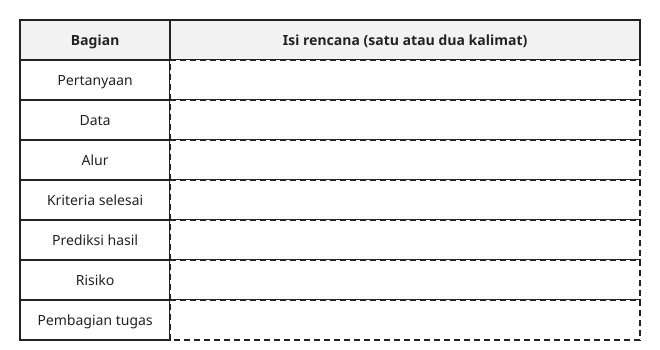

**Ingat dulu:** Tanpa melihat catatan, jawab. (1) Mengapa menilai model pada data latih menyesatkan? ______ (2) Mengapa aturan harus diuji pada kartu yang tidak dipakai untuk membuatnya? ______



`[Gambar: tabel tujuh baris bagian rencana satu halaman (pertanyaan, data, alur, kriteria selesai, prediksi hasil, risiko, pembagian tugas) dengan kolom isi kosong untuk kamu tulis.]`

**Prediksi:** Dataset proyek `kedai.csv`, data karangan penjualan kedai fiktif. Fitur: `harga_ribu`, `diskon_persen`, `hari` (`kerja` atau `libur`); label `penjualan` (`laris` atau `sepi`). Baris 1 sampai 28 data latih, baris 29 sampai 40 data uji.

```text
harga_ribu,diskon_persen,hari,c#penjualan
8,0,kerja,sepi
8,5,kerja,sepi
3,10,kerja,laris
12,5,kerja,sepi
8,5,kerja,laris
3,0,libur,laris
8,0,kerja,sepi
10,20,kerja,sepi
3,0,kerja,sepi
10,10,kerja,laris
5,5,libur,laris
12,15,kerja,sepi
4,0,libur,laris
12,15,libur,sepi
6,20,kerja,laris
3,10,kerja,laris
4,10,kerja,laris
10,15,kerja,sepi
5,10,libur,laris
7,20,libur,laris
4,10,kerja,laris
12,10,kerja,sepi
12,15,kerja,sepi
12,10,kerja,laris
10,0,libur,sepi
6,0,kerja,sepi
10,5,libur,laris
3,0,kerja,sepi
8,0,kerja,sepi
12,15,kerja,sepi
7,0,kerja,sepi
6,0,kerja,laris
6,15,kerja,laris
8,0,kerja,sepi
8,15,kerja,laris
6,20,kerja,laris
12,0,kerja,sepi
10,15,kerja,sepi
8,10,libur,laris
5,20,libur,laris
```

Sebelum membuka Orange, tulis pada gambar rencana satu halamanmu, termasuk prediksi hasil: perkiraan CA uji ______ dan tebakan mayoritas pada 12 baris uji ______.

**Latihan:**

1. `AI: tanpa AI` Tulis empat jenis masalah kualitas data, dan sebut jenis mana yang kamu temukan di `kedai.csv`. ______
2. `AI: boleh` Bila Tree menebak 10 dari 12 baris uji dengan benar, berapa ketepatannya? ______
3. `AI: boleh` Dua widget apa yang disambungkan ke File untuk melihat tabel dan diagram sebar? ______
4. `AI: boleh` Tulis kalimat umpan balik untuk laporan kelompok lain dengan format: satu yang sudah baik, satu yang perlu diperbaiki, satu langkah berikutnya. ______

**Cek diri:**

- [ ] Saya menulis rencana dan prediksi sebelum mengerjakan.
- [ ] Saya melaporkan CA latih, CA uji, dan pembanding.
- [ ] Saya menyebut keterbatasan dengan jujur.

**Catatan cetak (untuk guru, tidak dicetak):** dua halaman A4. Kunci ada di modul `d-x1-m13` bagian "Kunci dan petunjuk". Lembar tidak memuat kolom identitas.
