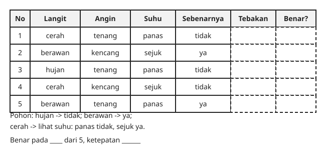

**Ingat dulu:** Tanpa membuka catatan, jawab (inti asesmen berjarak). (1) Apa beda program berbasis aturan dan sistem yang belajar dari data? Beri satu contoh tiap jenis. ______ (2) Bagaimana menghitung ketepatan, dan mengapa aturan diuji pada data yang tidak dipakai membuatnya? ______ (3) Mengapa ketepatan pada data latih menyesatkan, dan pembanding apa yang wajar? ______

`[Gambar: tabel lima kartu karangan (langit, angin, suhu, sebenarnya) dengan kolom tebakan dan benar kosong. Di bawahnya aturan pohon: hujan tidak, berawan ya, cerah lihat suhu (panas tidak, sejuk ya), dan tempat menulis ketepatan.]`

**Latihan:** Kerjakan tanpa AI.

1. Telusuri pohon pada gambar untuk lima kartu, isi kolom tebakan dan benar, dan tulis ketepatannya. ______
2. Tulis "aturan" atau "belajar": alarm jam; saran lagu berikutnya; kasir yang menjumlah belanjaan. Jelaskan satu jawabanmu. ______
3. Tabel penjualan buku karangan (no, harga ribu, stok, label): (1, 20, 5, laris); (2, 25, 3, sepi); (3, -10, 4, sepi); (4, 20, 5, laris); (5, 30, kosong, sepi); (6, 18, 6, laris); (7, 25, 3, laris). Tandai semua masalah dan jenisnya. ______
4. Hasil karangan: CA latih 0,95; CA uji 0,60; tebakan mayoritas pada data uji 0,55. Tulis tiga kalimat kesimpulan yang jujur. ______
5. Gambar diagram widget Orange (File, Tree, Test and Score, dan lainnya) untuk melatih pohon pada berkas latih dan mengujinya pada berkas uji. ______
6. Ubah `1010` biner ke desimal dan 255 desimal ke heksadesimal. ______

**Cek diri:**

- [ ] Saya dapat menelusuri pohon keputusan dan menghitung ketepatan.
- [ ] Saya dapat memeriksa dan menandai masalah pada tabel berlabel.
- [ ] Saya dapat menyimpulkan hasil dengan jujur, termasuk pembanding.

**Catatan cetak (untuk guru, tidak dicetak):** satu halaman A4. Kunci ada di modul `d-x1-m14` bagian "Kunci dan petunjuk". Lembar tidak memuat kolom identitas.
