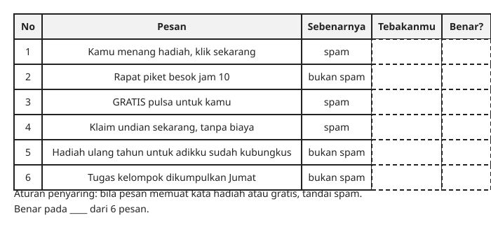

**Ingat dulu:** Tanpa melihat catatan, jawab. (1) Sebutkan tiga bagian model Input-Proses-Output dan beri contoh pada mesin kasir. ______ (2) Tulis bilangan biner 1101 dalam desimal. ______



`[Gambar: tabel enam pesan karangan bernomor 1 sampai 6 dengan kolom sebenarnya (spam atau bukan spam) terisi; kolom tebakanmu dan benar? kosong. Di bawahnya aturan penyaring dan tempat menulis jumlah pesan yang benar.]`

**Prediksi:** Sebuah penyaring memakai satu aturan yang ditulis manusia: bila pesan memuat kata "hadiah" atau "gratis", tandai spam (huruf besar atau kecil tidak membedakan). Tebak dulu untuk tiap pesan pada gambar, lalu tulis tebakanmu pada kolom Tebakanmu. Apakah semua tandanya akan benar? ______

**Lengkapi:** Pakai tabel kata ini (angka karangan, dari 10 contoh spam dan 10 contoh bukan spam).

| Kata | Pada contoh spam | Pada contoh bukan spam |
| --- | --- | --- |
| klaim | 8 | 0 |
| rapat | 0 | 6 |
| hadiah | 7 | 3 |

1. Kata "hadiah" muncul pada 7 + 3 = ____ pesan. Dari pesan itu, ____ merupakan spam, jadi sekitar ____ persen pesan yang memuat "hadiah" adalah spam.
2. Diagram I-P-O sistem yang belajar: Masukan: ____. Proses: model menghitung seberapa mirip pesan dengan pola yang ia pelajari. Keluaran: ____.
3. Pesan baru memuat "klaim" dan "rapat". Ke mana model cenderung menandainya, dan mengapa? ______

**Susun:** Urutkan langkah A sampai E untuk membangun sistem yang belajar dari data.

```text
(A) pakai model pada pesan baru dan pantau kesalahannya
(B) latih model dengan data latih
(C) kumpulkan contoh pesan dan beri label
(D) uji model dengan data uji yang belum pernah dilihat
(E) bagi contoh menjadi data latih dan data uji
```

Urutanku: ______

**Latihan:**

1. `AI: boleh` Tulis "aturan", "belajar", atau "tidak yakin" (dengan alasan) untuk tiap sistem: kalkulator; lampu lalu lintas dengan pengatur waktu tetap; saran video berikutnya di aplikasi; penerjemah otomatis; alarm jam. ______
2. `AI: tanpa AI` Sebuah sistem menebak jenis buah dari tabel ukuran dan warna (data karangan). Gambar diagram I-P-O-nya dan sebut satu data yang tidak boleh masuk tabel itu. ______
3. `AI: tanpa AI` Jelaskan kepada teman apa yang dapat dan tidak dapat dilakukan AI dalam dua kalimat. Hindari "AI berpikir seperti manusia". ______
4. `AI: boleh` Gambar kecil 3 kali 3 piksel berbentuk tanda tambah: baris 1 `0 1 0`, baris 2 `1 1 1`, baris 3 `0 1 0` (1 = hitam). Tulis sembilan bit-nya berurutan. ______

**Cek diri:**

- [ ] Saya dapat membedakan sistem berbasis aturan dan sistem yang belajar dari data.
- [ ] Saya dapat menggambar diagram I-P-O untuk sistem AI.
- [ ] Saya tahu data apa yang tidak boleh dipakai di jalur D.

**Catatan cetak (untuk guru, tidak dicetak):** satu sampai dua halaman A4. Kunci ada di modul `d-x1-m8` bagian "Kunci dan petunjuk". Lembar tidak memuat kolom identitas.
