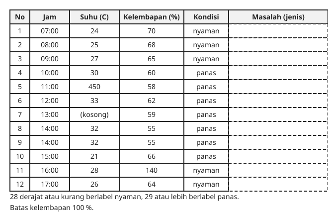

**Ingat dulu:** Tanpa melihat catatan, jawab. (1) Apa beda program berbasis aturan dan sistem yang belajar dari data? ______ (2) Kelompokkan sebagai masukan atau keluaran: pemindai kode batang, pengeras suara, layar sentuh. ______



`[Gambar: tabel dua belas baris catatan sensor ruang kelas karangan dengan kolom no, jam, suhu, kelembapan, dan kondisi terisi; kolom masalah kosong. Di bawahnya aturan label: 28 derajat atau kurang nyaman, 29 atau lebih panas, kelembapan paling tinggi 100 persen.]`

**Prediksi:** Dari 12 baris pada gambar, berapa baris yang menurutmu bermasalah? ______ Tandai barisnya dan tulis alasan serta jenis masalahnya (nilai mustahil, nilai hilang, baris ganda, atau label salah) pada kolom Masalah.

**Lengkapi:** Tabel karangan kartu benda berikut berlabel `alat tulis` atau `bukan`.

| No | Benda | Panjang (cm) | Ada ujung | Label |
| --- | --- | --- | --- | --- |
| 1 | pensil | 17 | ya | alat tulis |
| 2 | penggaris | 30 | tidak | alat tulis |
| 3 | botol | 22 | tidak | alat tulis |
| 4 | pulpen | 15 | ya | alat tulis |
| 5 | tas | -5 | tidak | bukan |
| 6 | pulpen | 15 | ya | alat tulis |

1. Fiturnya adalah ____ dan ____; labelnya adalah ____.
2. Baris ____ memuat nilai mustahil karena ____.
3. Baris ____ dan baris ____ adalah baris ganda.
4. Baris ____ kemungkinan label salah karena ____.

**Susun:** Urutkan langkah A sampai E untuk menyiapkan dataset berlabel.

```text
(A) simpan tabel bersih bersama catatan sumber dan perubahan
(B) tulis pertanyaan yang ingin dijawab dan pedoman memberi label
(C) periksa data ganjil: mustahil, kosong, ganda, label salah
(D) beri label pada tiap contoh sesuai pedoman
(E) kumpulkan contoh
```

Urutanku: ______

**Latihan:**

1. `AI: tanpa AI` Pada tabel sensor, tunjuk satu contoh, dua fitur, dan labelnya. Jelaskan dengan kata sendiri mengapa label disebut "jawaban yang benar". ______
2. `AI: tanpa AI` Sebuah perpustakaan karangan ingin menebak apakah sore hari ramai atau sepi. Kolom yang ada: nama lengkap, nomor telepon, jam datang, jumlah buku dipinjam. Mana yang dipakai, mana yang tidak dikumpulkan, dan mengapa? ______
3. `AI: boleh` Dari 100 catatan, 95 berlabel `nyaman`. Berapa persen ketepatan aturan "selalu nyaman"? Mengapa angka itu belum membuktikan model baik? ______
4. `AI: boleh` Satu byte (8 bit) menyimpan nilai paling besar 255. Apakah suhu 450 muat dalam satu byte? Tulis 450 dalam biner dan hitung banyak bit yang dibutuhkan. ______

**Cek diri:**

- [ ] Saya dapat menunjuk contoh, fitur, dan label pada sebuah tabel.
- [ ] Saya dapat menandai nilai mustahil, kosong, baris ganda, dan label salah.
- [ ] Saya tahu kolom apa yang tidak boleh dikumpulkan.

**Catatan cetak (untuk guru, tidak dicetak):** satu sampai dua halaman A4. Kunci ada di modul `d-x1-m9` bagian "Kunci dan petunjuk". Lembar tidak memuat kolom identitas.
