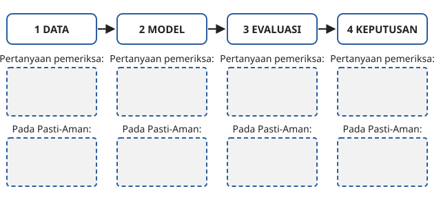

**Ingat dulu:** Tanpa melihat catatan, jawab. (1) Mengapa menilai model pada data latih menyesatkan? (2) Sebutkan empat jenis masalah kualitas data. ______

`[Gambar: empat kotak berpanah: Data, Model, Evaluasi, Keputusan. Di bawah tiap kotak ada kotak isian kosong untuk satu pertanyaan pemeriksa tahap itu, dan satu kotak isian kosong untuk jawabannya pada laporan "Pasti-Aman".]`

**Prediksi:** Sebuah laporan fiktif berbunyi: "Model Pasti-Aman: ketepatan 0,90 pada 30 baris data sungai (label `aman` atau `waspada`). Kesimpulan: model siap dipakai untuk memutuskan kapan warga diberi peringatan." Tebak dan tulis: (1) model seperti apa yang bisa memperoleh 0,90 tanpa memahami apa pun tentang hujan atau air; (2) apakah kamu mau memakainya untuk memberi peringatan.

(1) ______________________________

(2) ______________________________

**Lengkapi:** Laporan fiktif kedua: sebuah sistem memeriksa 20 komponen uji, 16 `normal` dan 4 `rusak`. Model menjawab benar pada 17 komponen; laporan menyebut "ketepatan 0,85".

1. Ketepatan = ____ dari 20 = ____.
2. Tebakan mayoritas (selalu `normal`) benar pada ____ dari 20 = ____.
3. Selisih model dengan tebakan mayoritas ____ poin persen, yaitu ____ komponen.
4. Komponen `rusak` yang tertangkap ada ____ dari 4.
5. Keputusan yang masuk akal dan alasannya: ______________________________

**Susun:** Urutkan langkah menelaah sebuah laporan model. Tulis huruf dari langkah pertama sampai terakhir.

- **A.** hitung tebakan mayoritas dan bandingkan dengan ketepatan yang dilaporkan
- **B.** baca apa yang dilaporkan: dari mana data, dan diuji pada data apa
- **C.** hitung berapa kejadian langka yang tertangkap
- **D.** tulis keputusan (pakai, perbaiki, atau tolak) beserta alasannya
- **E.** gambar alur data, model, evaluasi, keputusan dan tandai tahap yang bermasalah

Urutan: ____ , ____ , ____ , ____ , ____

**Latihan:**

1. (`AI: tanpa AI`) Laporan: "ketepatan 0,96 pada 25 baris; baris yang sama dipakai melatih dan menguji; 24 baris `normal` dan 1 `rusak`." Tulis semua yang janggal dan hitung tebakan mayoritasnya. ______________________________
2. (`AI: tanpa AI`) Mengapa hasil yang baik pada satu hari `waspada` di data uji belum cukup untuk memercayai pohon keputusan? ______________________________
3. (`AI: boleh`) Sebutkan dua hal yang kamu minta dari pembuat laporan "Pasti-Aman" supaya laporannya bisa dinilai. ______________________________
4. Sebuah aturan benar pada 8 dari 10 kartu uji. Berapa ketepatannya? ______

**Cek diri:**

- [ ] Saya dapat menyebut empat tahap alur dari data sampai keputusan.
- [ ] Saya selalu menghitung tebakan mayoritas sebelum memuji sebuah ketepatan.
- [ ] Saya memeriksa berapa kejadian langka yang tertangkap.

**Catatan cetak (untuk guru, tidak dicetak):** satu lembar A4, satu halaman. Kunci ada di modul `d-x2-m1`, bagian "Kunci dan petunjuk". Lembar tidak memuat kolom nama, kelas, tanggal, atau nilai.
