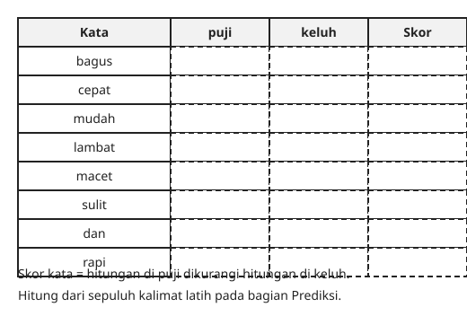

**Ingat dulu:** Tanpa melihat catatan, jawab. (1) Mengapa sumbu grafik batang harus mulai dari nol? ______ (2) Mengapa ketepatan tinggi bisa menyesatkan pada data yang timpang? ______ (3) Mengapa pengelompokan tidak bisa langsung dinilai dengan ketepatan? ______



`[Gambar: tabel delapan kata (bagus, cepat, mudah, lambat, macet, sulit, dan, rapi) dengan kolom puji, keluh, dan skor yang kosong untuk kamu hitung dari sepuluh kalimat latih. Skor kata = hitungan di puji dikurangi hitungan di keluh.]`

**Prediksi:** Sepuluh kalimat karangan tentang aplikasi fiktif "AplikasiBuku" sebagai data latih, lima `puji` dan lima `keluh`.

```text
puji:  aplikasinya mudah dipakai dan cepat
puji:  tampilan bagus dan rapi
puji:  fitur lengkap dan berguna
puji:  cepat sekali dan mudah
puji:  desain bagus dan nyaman
keluh: aplikasinya lambat dan sering macet
keluh: tampilan berantakan dan sulit dipakai
keluh: sering macet dan boros baterai
keluh: lambat sekali dan membingungkan
keluh: fitur kurang dan sulit dipahami
```

Tebak kategori tiga kalimat baru: (a) "rapi dan berguna" ______ (b) "lambat dan macet" ______ (c) "tidak mudah dipakai" ______ Bila komputer hanya menghitung kata, kalimat mana yang paling mungkin ia salahkan, dan mengapa? ______ Lalu hitung tabel pada gambar.

**Lengkapi:** Data latih karangan dengan dua kategori. bola: "tim mencetak gol", "gol indah tim tamu", "wasit meniup peluit"; masak: "ibu menggoreng ikan", "ikan goreng dengan minyak", "minyak panas dan ikan". Skor kata = hitungan di `bola` dikurangi hitungan di `masak`.

1. Skor `tim` = ____, `gol` = ____, `tamu` = ____, `ikan` = ____, `minyak` = ____, `panas` = ____, `dan` = ____.
2. "gol tim tamu": skor = ____, tebakan ____.
3. "ikan dan minyak panas": skor = ____, tebakan ____.
4. "tim makan ikan": `makan` tidak ada di tabel dan diabaikan, jadi skor = ____ + ____ + ____ = ____. Apakah tebakan ini layak dipercaya? ______

**Susun:** Urutkan langkah A sampai E menjadi alur teks.

```text
(A) hitung skor kalimat uji dari skor kata dan tebak kategorinya
(B) pecah tiap kalimat latih menjadi kata dan ubah ke huruf kecil
(C) periksa kesalahan: kalimat apa yang salah dan mengapa
(D) hitung tiap kata pada kategori pertama dan kedua, lalu beri skor kata
(E) hapus nama, kontak, dan data pribadi dari teks sebelum dipakai sebagai data
```

Urutanku: ______

**Latihan:**

1. `AI: tanpa AI` Dengan skor kata dari gambar dan tabelmu, hitung skor dan tebakan untuk "cepat dan bagus", "membingungkan dan lambat", dan "tidak lambat". Mana yang tebakannya bertentangan dengan artinya? ______
2. `AI: tanpa AI` Sebut empat kata yang skornya 0 pada tabelmu, dan jelaskan mengapa kata yang sering belum tentu berguna. ______
3. `AI: boleh` Tulis tiga kalimat uji karanganmu sendiri, tebak kategorinya sebelum menghitung, lalu hitung skornya dan catat satu kalimat yang paling sulit beserta alasannya. ______
4. `AI: boleh` Dari `d-x2-m3`: sebuah kumpulan ulasan nyata memuat nama dan nomor telepon. Apa yang harus dilakukan sebelum teks itu dipakai sebagai data latih? ______

**Cek diri:**

- [ ] Saya dapat menghitung skor kata dari data latih dan menebak kategori kalimat baru.
- [ ] Saya dapat menyebut apa yang hilang pada kantung kata dan memberi contoh kegagalannya.
- [ ] Saya melaporkan jenis kesalahan, bukan hanya ketepatan.

**Catatan cetak (untuk guru, tidak dicetak):** dua halaman A4. Kunci ada di modul `d-x2-m10` bagian "Kunci dan petunjuk". Lembar tidak memuat kolom identitas.
