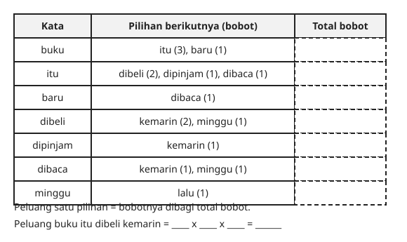

**Ingat dulu:** Tanpa melihat catatan, jawab. (1) Apa itu kantung kata, dan apa yang hilang darinya? ______ (2) Sebutkan dua hak pemilik data pribadi menurut UU Pelindungan Data Pribadi. ______ (3) Mengapa keluaran sistem AI harus diperiksa sebelum dipercaya? ______



`[Gambar: tabel tujuh kata (buku, itu, baru, dibeli, dipinjam, dibaca, minggu) dengan pilihan kata berikutnya dan bobotnya; kolom total bobot kosong. Di bawahnya tempat menghitung peluang kalimat "buku itu dibeli kemarin".]`

**Prediksi:** Mesin mini menyusun kalimat dengan memilih kata berikutnya menurut tabel peluang karangan pada gambar, mulai dari `buku`. Makin besar bobot, makin sering dipilih. Mesin dijalankan enam kali dengan benih acak berbeda. Tebak dan tulis: (1) apakah keenam kalimat sama? ______ (2) kalimat mana yang paling sering muncul dalam jangka panjang? ______ (3) apakah ada yang janggal tata bahasanya? ______ Lalu isi total bobot dan hitung peluang pada gambar.

**Lengkapi:** Teks karangan: "Gunung Fiktif adalah gunung tertinggi di Pulau Contoh. Tingginya 9.000 meter. Ia pertama kali didaki pada 1850." Sumber fiktif yang kamu pegang: tabel resmi Pulau Contoh dengan tiga gunung (Gunung Fiktif 2.100 meter, Gunung Cadangan 3.400 meter, Gunung Ketiga 1.800 meter) tanpa tahun pendakian. Status: didukung, bertentangan, atau tidak ditemukan.

1. Klaim 1: "tertinggi di Pulau Contoh", status: ____, karena tabel mencatat ____ lebih tinggi.
2. Klaim 2: "tingginya 9.000 meter", status: ____, karena tabel menyebut ____ meter.
3. Klaim 3: "pertama kali didaki pada 1850", status: ____, karena tabel ____.
4. Apakah nada kalimat yang yakin membantu menentukan status? ______
5. Langkah berikutnya untuk klaim "tidak ditemukan": ______

**Susun:** Urutkan langkah A sampai E menjadi alur memverifikasi jawaban AI.

```text
(A) beri status tiap klaim: didukung, bertentangan, atau tidak ditemukan
(B) pecah jawaban menjadi klaim yang bisa diperiksa satu per satu
(C) buka sumber primer atau resmi untuk tiap klaim dan catat tanggal akses
(D) bila ragu, cari sumber kedua dan jangan menyebarkan klaim itu
(E) baca jawaban sampai selesai tanpa langsung menyalinnya
```

Urutanku: ______

**Latihan:**

1. `AI: tanpa AI` Dari tabel peluang pada gambar, apakah kalimat yang paling sering muncul pasti yang paling benar? Jelaskan. ______
2. `AI: boleh` Dari `d-x2-m10`: mesin mini dan kantung kata sama-sama hanya bekerja dengan kata. Apa yang tidak mereka miliki? ______
3. `AI: boleh` Dari `d-x2-m3`: mengapa tidak boleh menaruh nama dan alamat teman di permintaan ke layanan AI, bahkan untuk "sekadar contoh"? ______

**Cek diri:**

- [ ] Saya dapat menjelaskan secara kasar bagaimana AI generatif menyusun teks.
- [ ] Saya dapat mengisi lembar verifikasi dari sumber primer.
- [ ] Saya dapat membedakan AI sebagai subjek dan sebagai alat.

**Catatan cetak (untuk guru, tidak dicetak):** dua halaman A4. Kunci ada di modul `d-x2-m11` bagian "Kunci dan petunjuk". Lembar tidak memuat kolom identitas.
