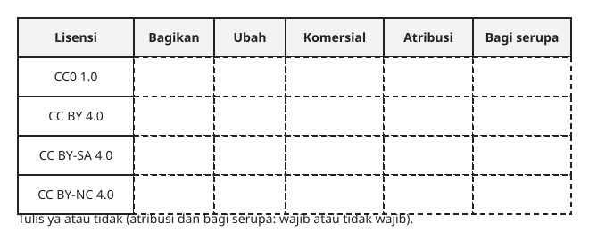

**Ingat dulu:** Tanpa melihat catatan, jawab. (1) Mengapa jawaban AI yang lancar belum tentu benar? ______ (2) Mengapa rata-rata saja bisa menyesatkan, dan apa pelengkapnya? ______



`[Gambar: tabel empat lisensi (CC0 1.0, CC BY 4.0, CC BY-SA 4.0, CC BY-NC 4.0) dengan kolom bagikan, ubah, komersial, atribusi, dan bagi serupa yang kosong untuk kamu isi.]`

**Prediksi:** Lima situasi karangan. Tebak dan tulis boleh atau tidak.

1. Memakai dataset CC BY 4.0 untuk proyek kelas dan menyebut pembuatnya. ______
2. Memakai dataset CC BY-NC 4.0 di aplikasi yang dijual. ______
3. Mengubah dataset CC BY-SA 4.0 lalu menerbitkannya dengan lisensi "semua hak dilindungi". ______
4. Memakai dataset tanpa keterangan lisensi karena "ada di internet". ______
5. Menyalin dataset CC0 tanpa menyebut pembuatnya. ______

Lalu isi tabel pada gambar dan periksa tebakanmu.

**Lengkapi:** Dataset karangan "Suhu Kota Contoh" berlisensi CC BY-SA 4.0. Kamu menambah satu kolom hitungan dan ingin membagikan hasilnya di kelas dan di internet.

1. Boleh mengubah (menambah kolom)? ____
2. Wajib menyebut atribusi? ____ Wajib memberi tahu bahwa ada perubahan? ____
3. Hasil turunan harus dibagikan dengan lisensi ____.
4. Boleh dipakai di produk berbayar? ____ Mengapa? ______
5. Catatan atribusi TASL (judul, pencipta, sumber, lisensi) dengan pembuat "Kelompok Contoh" dan sumber `https://data.example/suhu`: ______

**Susun:** Urutkan langkah A sampai E menjadi alur memakai dataset secara sah.

```text
(A) bandingkan syarat lisensi dengan rencana pakai: bagikan, ubah, komersial
(B) bila lisensi tidak ada atau tidak jelas, jangan pakai atau minta izin tertulis
(C) catat judul, pencipta, sumber, lisensi, dan tanggal akses di tabel lisensi
(D) cari keterangan lisensi di halaman sumber dataset
(E) periksa hak lain: data pribadi, potret, dan syarat tambahan
```

Urutanku: ______

**Latihan:**

1. `AI: tanpa AI` Enam dataset karangan: D1 CC0, D2 CC BY 4.0, D3 CC BY-SA 4.0, D4 CC BY-NC 4.0, D5 tanpa keterangan lisensi, D6 CC BY 4.0. Proyekmu aplikasi berbayar. Isi boleh atau tidak untuk tiap dataset dan sebut syaratnya; hitung berapa yang boleh. ______
2. `AI: tanpa AI` Tulis catatan TASL untuk dataset karangan "Panjang Kerang" oleh "Pembuat Contoh", sumber `https://data.example/kerang`, lisensi CC BY 4.0, setelah kamu menghapus tiga baris. ______
3. `AI: boleh` Dari `d-x2-m3`: sebuah dataset terbuka berlisensi CC BY memuat kolom alamat rumah. Mengapa lisensi saja belum cukup untuk memakainya? ______

**Cek diri:**

- [ ] Saya dapat membaca lisensi dan menyebut apa yang boleh dan syaratnya.
- [ ] Saya dapat menulis catatan atribusi TASL.
- [ ] Saya dapat menjelaskan bahwa hak cipta timbul otomatis dan kompilasi data dapat dilindungi.

**Catatan cetak (untuk guru, tidak dicetak):** dua halaman A4. Kunci ada di modul `d-x2-m12` bagian "Kunci dan petunjuk". Lembar tidak memuat kolom identitas.
