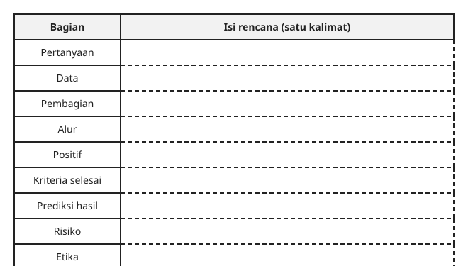

**Ingat dulu:** Tanpa melihat catatan, jawab. (1) Apa yang wajib dicatat saat memakai data berlisensi? ______ (2) Mengapa ketepatan 0,833 pada enam kalimat uji belum membuktikan banyak? ______ (3) Mengapa model yang lebih rumit tidak selalu lebih baik? ______

`[Gambar: tabel sembilan baris bagian rencana satu halaman (pertanyaan, data, pembagian, alur, positif, kriteria selesai, prediksi hasil, risiko, etika) dengan kolom isi kosong untuk kamu tulis.]`

**Prediksi:** Dataset contoh `kompos.csv`: data karangan tentang tumpukan kompos fiktif, 44 baris. Fitur `suhu_c` dan `lembap_persen`; label `kompos` (`matang` atau `belum`). Baris 1 sampai 32 data latih (7 `matang`, 25 `belum`), baris 33 sampai 44 data uji (4 `matang`, 8 `belum`). Sebelum membuka Orange, isi rencana satu halaman pada gambar, termasuk prediksi hasil. Pada 12 baris uji, berapa ketepatan tebakan mayoritas? ______ Berapa perkiraan ketepatan uji modelmu? ______

**Latihan:**

1. `AI: tanpa AI` Mengapa pembagian latih dan uji harus ditetapkan sebelum melihat hasil dan tidak diubah demi hasil yang lebih bagus? ______
2. `AI: boleh` Dari `d-x2-m7`: bila kNN menangkap sebagian `matang`, apa dampak satu FN dibanding satu FP pada kasus kompos fiktif ini? ______
3. `AI: boleh` Dari `d-x2-m12`: kelompokmu ingin memakai data suhu kompos dari situs berlisensi CC BY-NC dan memajangnya pada proyek kelas tanpa iklan. Apa langkah pertamamu? ______
4. `AI: boleh` Dari `d-x2-m9`: grafik apa yang cocok untuk membandingkan ketepatan tiga model, dan aturan sumbu apa yang harus dipatuhi? ______

**Cek diri:**

- [ ] Saya menulis rencana dan prediksi sebelum menjalankan model.
- [ ] Saya menyebut keterbatasan: ukuran data uji, data karangan, satu pembagian.
- [ ] Saya memberi umpan balik sejawat dengan format tiga bagian.

**Catatan cetak (untuk guru, tidak dicetak):** dua halaman A4. Kunci ada di modul `d-x2-m13` bagian "Kunci dan petunjuk". Lembar tidak memuat kolom identitas.
