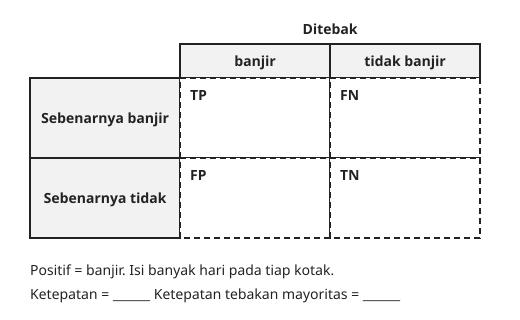

**Ingat dulu:** Tanpa membuka catatan, jawab (inti asesmen berjarak, `AI: tanpa AI`). (1) Mengapa selisih satu atau dua baris pada data uji kecil belum membuktikan model yang satu lebih baik? ______ (2) Apa beda CC BY dan CC BY-NC? ______ (3) Apa saja isi rencana proyek yang ditulis sebelum mengerjakan? ______

`[Gambar: kotak dua kali dua dengan baris sebenarnya banjir dan tidak banjir, kolom ditebak banjir dan tidak banjir; empat kotak kosong berlabel TP, FN, FP, TN untuk diisi banyak hari. Di bawahnya tempat menulis ketepatan dan ketepatan tebakan mayoritas.]`

**Latihan:** Kerjakan tanpa AI.

1. Sistem peringatan banjir fiktif memeriksa 25 hari. Dari 5 hari yang sebenarnya banjir, 3 ditebak banjir dan 2 tidak. Dari 20 hari yang sebenarnya tidak banjir, 2 ditebak banjir dan 18 tidak. Dengan banjir sebagai positif, isi matriks pada gambar, hitung ketepatan, bandingkan dengan tebakan mayoritas, dan tulis berapa hari banjir yang tertangkap. ______
2. Nilai sebenarnya 10, 12, 15, 20, 23; tebakan model 11, 11, 17, 19, 26. Hitung selisih, MAE, dan RMSE, lalu jelaskan mengapa RMSE tidak lebih kecil dari MAE. ______
3. Titik latih kelas A: (1, 2), (2, 1), (2, 3); kelas B: (6, 5), (7, 7), (8, 5). Dengan k = 3 dan jarak² (selisih x dikuadratkan ditambah selisih y dikuadratkan), tebak kelas titik baru (3, 5). ______
4. Sebuah grafik batang fiktif menampilkan dua model dengan ketepatan 98 dan 100 persen pada sumbu yang mulai dari 96, berjudul "Model B jauh lebih baik". Tulis dua masalah pada grafik itu dan satu judul yang jujur. ______

**Cek diri:**

- [ ] Saya dapat membaca matriks kebingungan, menghitung ketepatan dan galat, dan membandingkannya dengan pembanding.
- [ ] Saya dapat menelusuri kNN dengan tangan.
- [ ] Saya dapat memilih grafik dan judul yang jujur.

**Catatan cetak (untuk guru, tidak dicetak):** satu halaman A4. Kunci ada di modul `d-x2-m14` bagian "Kunci dan petunjuk". Lembar tidak memuat kolom identitas.
