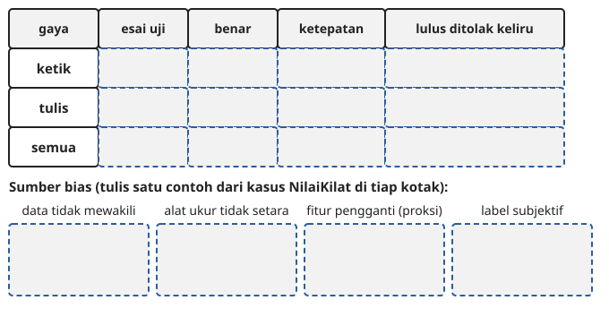

**Ingat dulu:** Tanpa melihat catatan, jawab. (1) Apa beda program berbasis aturan dan sistem yang belajar dari data? (2) Mengapa "lebih banyak contoh" belum tentu menjamin model yang adil dan benar? ______

`[Gambar: tabel hasil uji 12 esai NilaiKilat dengan kolom gaya, jumlah esai, jumlah benar, ketepatan, dan lulus ditolak keliru. Baris ketik dan tulis serta baris keseluruhan dibiarkan kosong untuk diisi. Di bawahnya empat kotak kosong bertanda sumber bias: data tidak mewakili, alat ukur tidak setara, fitur pengganti, label subjektif.]`

**Prediksi:** Sistem fiktif "NilaiKilat" memutuskan `lulus` atau `ulang` untuk esai dari fitur `kata` dan `salah_eja` (dihitung otomatis dari naskah yang dipindai). Esai ada dua gaya: `ketik` dan `tulis` (tulisan tangan yang dipindai dan dibaca mesin). Data latih: 20 esai, 16 `ketik` dan 4 `tulis`; keempat esai `tulis` semuanya `ulang`. Data uji: 12 esai, 6 `ketik` dan 6 `tulis`. Kolom `gaya` tidak dipakai model. Tebak: (1) ketepatan keseluruhan pada 12 esai uji, (2) ketepatan pada tiap gaya, (3) gaya mana yang lebih sering dinilai keliru, dan mengapa.

______________________________

**Lengkapi:** Sebuah alat baca-nilai fiktif diuji pada kelompok P dan Q, masing-masing 10 esai (8 sebenarnya `lulus`, 2 `ulang`). Pada P ada 1 esai `lulus` yang ditolak keliru; pada Q ada 4. Semua esai `ulang` ditebak benar di kedua kelompok.

1. Ketepatan P = ____ dari 10 = ____; ketepatan Q = ____ dari 10 = ____.
2. Ketepatan keseluruhan = ____ dari 20 = ____.
3. Selisih ketepatan P dan Q = ____ poin persen.
4. `Lulus` yang ditolak keliru: P = ____ dari 8 = ____; Q = ____ dari 8 = ____.
5. Apa yang disembunyikan ketepatan keseluruhan? ______________________________

**Susun:** Urutkan langkah memeriksa bias sebuah model.

- **A.** hitung ketepatan dan tingkat salah untuk tiap kelompok
- **B.** tentukan kelompok yang akan dibandingkan (tanpa data pribadi)
- **C.** bandingkan selisihnya dan catat siapa yang dirugikan
- **D.** telusuri sumber: data, alat ukur, fitur pengganti, label
- **E.** tulis catatan kasus dan satu usulan perbaikan

Urutan: ____ , ____ , ____ , ____ , ____

**Latihan:**

1. (`AI: tanpa AI`) Dari tabel pada gambar yang sudah kamu isi, bandingkan ketepatan tiap gaya dan banyaknya esai `lulus` yang ditolak keliru tiap gaya. ______________________________
2. (`AI: tanpa AI`) Seorang teman berkata, "Kolom `gaya` tidak dipakai model, jadi model ini pasti adil." Setuju atau tidak? Beri dua alasan dari data. ______________________________
3. (`AI: boleh`) Tiga usulan: (a) menambah esai tulisan tangan yang `lulus` ke data latih, (b) mengukur salah ejaan dengan cara yang sama untuk kedua gaya, (c) esai yang ditolak ditinjau manusia. Urutkan dari yang paling mengatasi sebab, dan sebut satu kekurangan tiap usulan. ______________________________

**Cek diri:**

- [ ] Saya dapat menyebut empat sumber bias.
- [ ] Saya menghitung ketepatan dan tingkat salah per kelompok.
- [ ] Saya tahu bahwa membuang kolom kelompok belum tentu cukup.

**Catatan cetak (untuk guru, tidak dicetak):** satu lembar A4, satu halaman. Kunci ada di modul `d-x2-m2`, bagian "Contoh terselesaikan" dan "Latihan" (kunci). Lembar tidak memuat kolom nama, kelas, tanggal, atau nilai.
