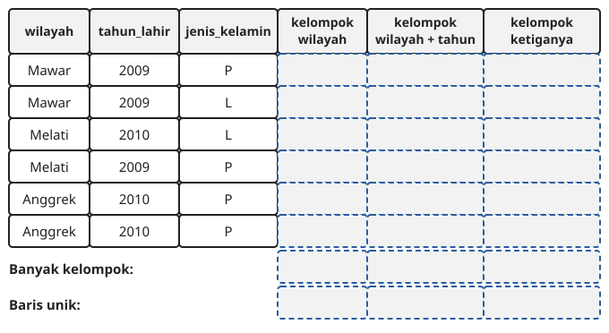

**Ingat dulu:** Tanpa melihat catatan, jawab. (1) Kolom apa yang tidak boleh dikumpulkan karena memuat data pribadi, dan mengapa? (2) Apa itu fitur dan apa itu label? Beri contoh. ______

`[Gambar: tabel enam baris dengan kolom wilayah, tahun_lahir, jenis_kelamin, dan tiga kolom kosong untuk nomor kelompok menurut wilayah saja, menurut wilayah dan tahun_lahir, serta menurut ketiganya. Di bawahnya tiga kotak kosong untuk banyak kelompok dan baris unik.]`

**Prediksi:** Tabel karangan `klub.csv` berisi 12 anggota klub sains fiktif, tanpa kolom nama, dengan kolom `wilayah` (Mawar, Melati, Anggrek), `tahun_lahir` (2008 sampai 2010), dan `jenis_kelamin`. Bayangkan seseorang tahu wilayah, tahun lahir, dan jenis kelamin temanmu, tanpa namanya. Tebak: (1) dari 12 baris, berapa yang dapat ia tunjuk sebagai satu baris saja? (2) Apakah tabel tanpa nama itu aman disebarkan?

(1) ______ (2) ______________________________

**Lengkapi:** Tabel karangan enam baris pada gambar. Baris disebut unik bila ia satu-satunya anggota kelompoknya.

1. Menurut `wilayah` saja ada ____ kelompok dan ____ baris unik.
2. Menurut `wilayah` dan `tahun_lahir` ada ____ kelompok dan ____ baris unik.
3. Menurut ketiga kolom ada ____ kelompok dan ____ baris unik.
4. Kombinasi mana yang paling mudah dipakai untuk menunjuk seseorang? ______
5. Satu cara mengurangi risikonya tanpa membuang semua kolom: ______________________________

**Susun:** Urutkan langkah menyiapkan data yang aman dipakai.

- **A.** tentukan tujuan dan kolom minimal yang benar-benar diperlukan
- **B.** tandai tiap kolom: langsung, kombinasi, atau spesifik
- **C.** buang atau samarkan kolom yang tidak diperlukan
- **D.** hitung baris unik pada kombinasi kolom yang tersisa
- **E.** tulis daftar periksa privasi

Urutan: ____ , ____ , ____ , ____ , ____

**Latihan:**

1. (`AI: tanpa AI`) Pendaftaran lomba robot fiktif menanyakan: nama lengkap, tanggal lahir, alamat rumah, golongan darah, ukuran kaos, dan jenis robot. Tandai mana langsung, kombinasi, spesifik, atau bukan data pribadi, dan kolom mana yang kamu hapus. ______________________________
2. (`AI: boleh`) Seorang teman ingin menempelkan daftar kelas beserta nama ke layanan AI daring agar tabelnya dirapikan. Tulis saranmu dan satu cara lain yang aman. ______________________________
3. (`AI: tanpa AI`) Sebutkan tiga hak pemilik data pribadi menurut pokok UU dan satu situasi karangan untuk salah satunya. ______________________________

**Cek diri:**

- [ ] Saya dapat membedakan data langsung, kombinasi, dan spesifik.
- [ ] Saya menghitung baris unik sebelum menyebarkan sebuah tabel.
- [ ] Saya tidak menaruh data pribadi, kata sandi, atau kunci ke layanan AI.

**Catatan cetak (untuk guru, tidak dicetak):** satu lembar A4, satu halaman. Kunci ada di modul `d-x2-m3`, bagian "Contoh terselesaikan" dan "Kunci dan petunjuk". Lembar tidak memuat kolom nama, kelas, tanggal, atau nilai.
