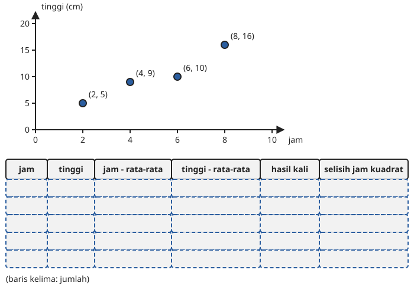

**Ingat dulu:** Tanpa melihat catatan, jawab. (1) Apa beda menebak kategori dan menebak angka? (2) Apa itu tebakan mayoritas dan mengapa dipakai sebagai pembanding? ______

`[Gambar: diagram sebar dengan sumbu lama sinar (jam) dan tinggi (cm) memuat empat titik (2, 5), (4, 9), (6, 10), (8, 16), ruang untuk menggambar garis, dan tabel penelusuran kosong dengan kolom jam, tinggi, jam dikurangi rata-rata, tinggi dikurangi rata-rata, hasil kali, dan selisih jam dikuadratkan.]`

**Prediksi:** Dataset karangan lima hari di warung es fiktif: suhu siang 28, 30, 32, 34, 36 derajat Celsius dengan gelas terjual 30, 42, 55, 60, 78. Sebelum menghitung, tebak: (1) kira-kira berapa gelas terjual pada hari bersuhu 33; (2) tiap kenaikan suhu 1 derajat, kira-kira bertambah berapa gelas.

(1) ______ (2) ______

**Lengkapi:** Garis regresi linear: `terjual = titik potong + kemiringan x suhu`. Kemiringan = jumlah (selisih x dari rata-rata dikali selisih y dari rata-rata), dibagi jumlah (selisih x dari rata-rata dikuadratkan). Tanaman fiktif pada gambar: lama sinar per hari (jam) dan tinggi (cm): (2, 5), (4, 9), (6, 10), (8, 16). Isi tabel pada gambar, lalu:

1. Rata-rata jam = ____ dan rata-rata tinggi = ____.
2. Jumlah hasil kali selisih = ____ dan jumlah selisih jam dikuadratkan = ____.
3. Kemiringan = ____ dan titik potong = ____.
4. Prediksi tinggi untuk 5 jam = ____ cm.
5. Mengapa memprediksi untuk 20 jam tidak dapat dipercaya? ______________________________

**Susun:** Urutkan langkah membuat alur regresi di Orange.

- **A.** sambungkan File ke Scatter Plot dan lihat apakah titik-titik cenderung lurus
- **B.** sambungkan File ke Linear Regression
- **C.** sambungkan Linear Regression ke Predictions untuk nilai suhu baru
- **D.** muat berkas CSV dengan File dan periksa kolom target
- **E.** catat koefisien dan galat, lalu tulis batas penggunaannya

Urutan: ____ , ____ , ____ , ____ , ____

**Latihan:**

1. (`AI: tanpa AI`) Tandai regresi atau klasifikasi: (a) menebak apakah tanaman `segar` atau `layu`, (b) menebak tinggi tanaman, (c) menebak banyak gelas es terjual, (d) menebak apakah pesan `spam`. ______________________________
2. (`AI: tanpa AI`) Dengan garis `terjual = -132,206 + 6,018 x suhu`, hitung prediksi untuk 45 derajat dan 0 derajat. Mengapa hasilnya tidak boleh dipakai untuk memutuskan stok? ______________________________
3. (`AI: boleh`) Tulis tiga kalimat tentang arti kemiringan garis es, rentang data, dan satu hal yang tidak dibuktikan garis itu. ______________________________

**Cek diri:**

- [ ] Saya dapat membedakan regresi dan klasifikasi.
- [ ] Saya dapat menghitung kemiringan dan titik potong dari beberapa titik.
- [ ] Saya menyebut rentang data setiap kali memberi prediksi.

**Catatan cetak (untuk guru, tidak dicetak):** satu lembar A4, satu halaman. Kunci ada di modul `d-x2-m4`, bagian "Contoh terselesaikan" dan "Kunci dan petunjuk". Lembar tidak memuat kolom nama, kelas, tanggal, atau nilai.
