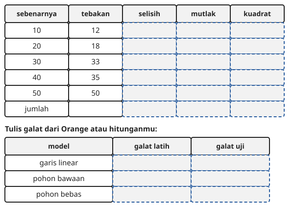

**Ingat dulu:** Tanpa melihat catatan, jawab. (1) Apa yang kamu periksa lebih dulu setelah memuat data? (2) Apa arti kemiringan garis regresi dalam kalimat biasa? (3) Sebutkan empat sumber bias pada sistem keputusan otomatis. ______

`[Gambar: tabel lima baris dengan kolom nilai sebenarnya (10, 20, 30, 40, 50) dan tebakan (12, 18, 33, 35, 50) terisi, serta kolom selisih, mutlak, dan kuadrat kosong; satu baris jumlah kosong di bawahnya. Di bawah tabel ada tiga baris kosong untuk model garis linear, pohon bawaan, dan pohon bebas dengan kolom galat latih dan galat uji.]`

**Prediksi:** Dataset karangan `tumbuh`: tinggi tanaman fiktif (cm) setelah 30 hari menurut jumlah air siraman per hari (ml), 12 baris data latih dan 8 baris data uji. Dua model dibandingkan: garis regresi linear (sederhana) dan pohon keputusan tanpa batas (rumit; boleh membuat daun untuk tiap baris latih). Tebak dan tulis: (1) model mana yang galatnya lebih kecil pada data latih, (2) model mana yang galatnya lebih kecil pada data uji, (3) mengapa keduanya bisa berbeda.

______________________________

**Lengkapi:** Sebuah model menebak lima nilai seperti pada gambar. Isi tabel pada gambar, lalu:

1. Selisih (sebenarnya - tebakan): ____, ____, ____, ____, ____.
2. Mutlak: ____, ____, ____, ____, ____; MAE = ____ / 5 = ____.
3. Kuadrat: ____, ____, ____, ____, ____; RMSE = akar dari (____ / 5) = ____ (dua desimal).
4. Model lain pada data latih benar semua (galat 0) tetapi pada data uji MAE-nya 6, sedangkan model pertama MAE latih 2,4 dan uji 2,8. Mana yang kamu pilih? Alasannya? ______________________________

**Susun:** Urutkan langkah membandingkan model sederhana dan rumit.

- **A.** latih kedua model pada data latih
- **B.** catat galat kedua model pada data latih
- **C.** catat galat kedua model pada data uji
- **D.** bandingkan jarak galat latih dan galat uji tiap model
- **E.** pilih model dengan galat uji lebih kecil dan tulis catatan galat

Urutan: ____ , ____ , ____ , ____ , ____

**Latihan:**

1. (`AI: tanpa AI`) Pohon bebas menebak 36, 36, 40, 40 untuk baris uji dengan air 330, 380, 500, 530 ml (sebenarnya 27, 18, 35, 43). Hitung MAE dan RMSE untuk empat baris itu. ______________________________
2. (`AI: tanpa AI`) Laporan A: RMSE latih 2,1 dan uji 2,4. Laporan B: RMSE latih 0,0 dan uji 7,9. Laporan mana yang menunjukkan kelebihan-suai? Apa yang kamu minta dari pembuat laporan itu? ______________________________
3. (`AI: boleh`) Tulis dua kalimat yang menjelaskan mengapa model dipilih dari galat uji, bukan galat latih. ______________________________

**Cek diri:**

- [ ] Saya dapat menghitung MAE dan RMSE dari selisih.
- [ ] Saya dapat mengenali kelebihan-suai dari jarak galat latih dan galat uji.
- [ ] Saya memilih model dari galat uji.

**Catatan cetak (untuk guru, tidak dicetak):** satu lembar A4, satu halaman. Kunci ada di modul `d-x2-m5`, bagian "Contoh terselesaikan" dan "Kunci dan petunjuk". Lembar tidak memuat kolom nama, kelas, tanggal, atau nilai.
