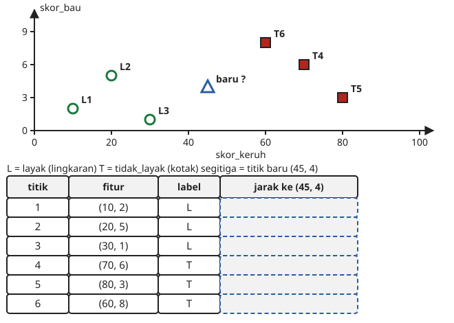

**Ingat dulu:** Tanpa melihat catatan, jawab. (1) Bagaimana pohon keputusan sampai pada sebuah label? (2) Bagaimana mengenali kelebihan-suai dari dua angka galat? (3) Mengapa menilai model pada data latih menyesatkan? ______

`[Gambar: diagram sebar dengan sumbu skor_keruh (0 sampai 100) dan skor_bau (0 sampai 9). Tiga titik berlabel L (layak) di kiri: (10, 2), (20, 5), (30, 1); tiga titik berlabel T (tidak_layak) di kanan: (70, 6), (80, 3), (60, 8); satu titik baru berlabel tanda tanya di (45, 4). Di bawahnya tabel kosong jarak ke titik baru.]`

**Prediksi:** Dataset karangan `sumur.csv`: 40 contoh air sumur fiktif dengan `skor_keruh` (0 sampai 100) dan `skor_bau` (0 sampai 9) yang karangan, label `layak` atau `tidak_layak`; 28 baris latih dan 12 baris uji. Data karangan: jangan dipakai menilai air sumur sungguhan. Tebak dan tulis: (1) mana yang lebih tepat pada data uji, pohon atau kNN, (2) berapa ketepatan tertingginya, (3) berapa ketepatan tebakan mayoritas.

______________________________

**Lengkapi:** kNN mencari k titik latih terdekat (jarak Euclid: akar dari jumlah kuadrat selisih tiap fitur) lalu memilih label terbanyak di antara mereka. Gunakan enam titik latih dan titik baru (45, 4) pada gambar.

1. Jarak mentah ke tiap titik latih, sesuai urutan di tabel gambar (dua desimal): ____, ____, ____, ____, ____, ____.
2. Dengan k = 1, tetangga terdekat berlabel ____, jadi tebakan ____.
3. Dengan k = 3, tiga terdekat berlabel ____, ____, ____, jadi tebakan ____.
4. Dengan k = 5, tebakan menjadi ____. Mengapa jawabannya bisa berubah bila k berubah? ______________________________

**Susun:** Urutkan langkah membandingkan dua penggolong.

- **A.** latih pohon dan kNN pada data latih yang sama
- **B.** uji keduanya pada data uji yang sama
- **C.** hitung tebakan mayoritas sebagai pembanding
- **D.** isi tabel perbandingan: CA latih dan CA uji tiap model
- **E.** tulis kesimpulan jujur yang menyebut ukuran data uji

Urutan: ____ , ____ , ____ , ____ , ____

**Latihan:**

1. (`AI: boleh`) kNN jarak mentah pada `sumur.csv` memberi: k = 1: CA latih 1,000 dan uji 1,000; k = 3: 0,857 dan 0,917; k = 5: 0,857 dan 0,917; k = 9: 0,786 dan 0,917. Jelaskan mengapa k = 1 memberi CA latih 1,000. ______________________________
2. (`AI: tanpa AI`) Model A benar 11 dari 12 baris uji dan model B 9 dari 12. Berapa poin persen selisihnya, dan apa kesimpulan yang jujur? ______________________________
3. (`AI: tanpa AI`) Apakah model ini boleh dipakai memutuskan air sumur sungguhan layak diminum? Beri dua alasan. ______________________________

**Cek diri:**

- [ ] Saya dapat menjelaskan cara kNN menebak sebuah titik.
- [ ] Saya menambahkan tebakan mayoritas pada tabel perbandingan.
- [ ] Saya menyebut ukuran data uji dalam kesimpulan.

**Catatan cetak (untuk guru, tidak dicetak):** satu lembar A4, satu halaman. Kunci ada di modul `d-x2-m6`, bagian "Contoh terselesaikan" dan "Kunci dan petunjuk". Lembar tidak memuat kolom nama, kelas, tanggal, atau nilai.
