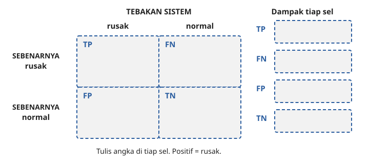

**Ingat dulu:** Tanpa melihat catatan, jawab. (1) Apa yang wajib ada di laporan hasil model selain angka ketepatan? (2) Mengapa jenis kesalahan perlu dilaporkan, bukan hanya ketepatan? (3) Apa yang membuat dua model pantas dibandingkan secara adil? ______

`[Gambar: matriks kebingungan dua kali dua. Baris: sebenarnya rusak dan sebenarnya normal. Kolom: tebakan rusak dan tebakan normal. Keempat sel kosong, masing-masing diberi label kecil TP, FN, FP, TN. Di sampingnya empat kotak kosong untuk menulis dampak tiap jenis sel.]`

**Prediksi:** Saringan pesan fiktif memeriksa 20 pesan karangan. Kelas positif adalah `spam`. Pesan yang sebenarnya spam: nomor 1, 7, 12, 18. Pesan yang ditebak spam oleh saringan: nomor 1, 12, 15. Selebihnya ditebak bukan spam. Tebak dan tulis: (1) berapa dari 20 tebakan yang benar, (2) berapa spam yang tertangkap, (3) apakah saringan ini layak dipakai.

______________________________

**Lengkapi:** Sebuah sistem fiktif mendeteksi komponen `rusak` (positif). Dari 30 komponen uji: sebenarnya `rusak` ada 5, ditebak `rusak` 3 dan ditebak `normal` 2; sebenarnya `normal` ada 25, ditebak `rusak` 4 dan ditebak `normal` 21. Isi matriks pada gambar, lalu:

1. TP = ____, FN = ____, FP = ____, TN = ____.
2. Ketepatan = (____ + ____) / 30 = ____.
3. Tebakan mayoritas (selalu `normal`) benar ____ dari 30 = ____. Mana yang lebih tinggi? ______
4. Komponen `rusak` yang tertangkap = ____ dari 5 = ____.
5. Walau ketepatannya lebih rendah dari tebakan mayoritas, mengapa sistem ini mungkin tetap berguna? ______________________________

**Susun:** Urutkan langkah mengevaluasi sebuah penggolong.

- **A.** tentukan kelas positif, yaitu yang ingin dikenali
- **B.** isi matriks dari daftar kelas sebenarnya dan tebakan
- **C.** hitung ketepatan dari diagonal dan bandingkan dengan tebakan mayoritas
- **D.** hitung FN dan FP dan tulis akibat tiap jenis kesalahan
- **E.** putuskan apakah model dipakai, diperbaiki, atau ditolak

Urutan: ____ , ____ , ____ , ____ , ____

**Latihan:**

1. (`AI: tanpa AI`) Pada 12 baris uji `sumur.csv`, kNN jarak mentah hanya salah di baris 32 (sebenarnya `layak`, ditebak `tidak_layak`); ada 9 baris sebenarnya `tidak_layak` dan 3 sebenarnya `layak`. Dengan positif = `tidak_layak`, tulis TP, FN, FP, TN, dan ketepatannya. ______________________________
2. (`AI: tanpa AI`) Matriks pohon di Orange `[[3, 0], [3, 6]]`, baris sebenarnya dan kolom tebakan, urutan kelas `layak` lalu `tidak_layak`. Tulis TP, FN, FP, TN, hitung ketepatan, lalu jelaskan dampak FN pada kasus air sumur. ______________________________
3. (`AI: boleh`) Pilih satu model dan tulis satu kalimat dampak untuk tiap sel (TP, FN, FP, TN) pada kasus air sumur fiktif. ______________________________

**Cek diri:**

- [ ] Saya dapat menghitung TP, FN, FP, TN dari daftar sebenarnya dan tebakan.
- [ ] Saya menyebut dampak positif palsu dan negatif palsu pada kasus yang dibahas.
- [ ] Saya membandingkan ketepatan dengan tebakan mayoritas.

**Catatan cetak (untuk guru, tidak dicetak):** satu lembar A4, satu halaman. Kunci ada di modul `d-x2-m7`, bagian "Contoh terselesaikan" dan "Kunci dan petunjuk". Lembar tidak memuat kolom nama, kelas, tanggal, atau nilai.
