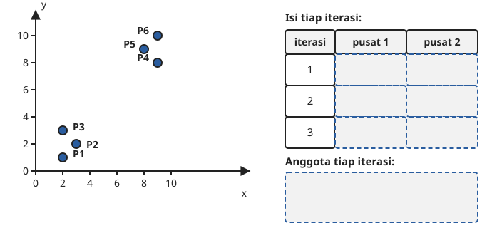

**Ingat dulu:** Tanpa melihat catatan, jawab. (1) Bagaimana membaca matriks kebingungan: baris, kolom, dan diagonal? (2) Bagaimana kNN menentukan titik mana yang "dekat"? (3) Apa beda fitur dan label? ______

`[Gambar: bidang dengan sumbu x dan y memuat enam titik P1 (2, 1), P2 (3, 2), P3 (2, 3), P4 (9, 8), P5 (8, 9), P6 (9, 10). Di bawahnya tabel kosong untuk tiga iterasi k-means dengan kolom pusat, anggota, dan pusat baru.]`

**Prediksi:** Pada klasifikasi, model belajar dari label. Pada pengelompokan, tidak ada label: komputer hanya mengelompokkan contoh yang mirip. Dataset karangan `kerang.csv` memuat 15 kerang fiktif dengan `panjang_mm` dan `berat_g`, tanpa kolom label: (66; 7,3), (66; 8,5), (43; 5,0), (47; 4,7), (62; 7,9), (28; 2,1), (43; 4,2), (64; 7,6), (31; 1,9), (28; 2,1), (48; 3,8), (29; 2,5), (63; 7,2), (25; 2,0), (50; 5,2). Tebak dan tulis: (1) berapa kelompok alami yang kamu lihat, (2) berapa kerang di tiap kelompok, (3) bila komputer dipaksa membuat dua kelompok, kerang mana yang akan digabung.

______________________________

**Lengkapi:** K-means mengulang tiga langkah: tetapkan tiap titik ke pusat terdekat (bandingkan jarak kuadrat), hitung pusat baru sebagai rata-rata anggota, ulangi sampai penetapan tidak berubah. Gunakan enam titik pada gambar, k = 2, pusat awal (2, 1) dan (3, 2).

1. Iterasi 1: P1 jatuh ke pusat ____; P2 sampai P6 ke pusat ____. Pusat baru 1 = (____, ____); pusat baru 2 = (____, ____), rata-rata dari ____ titik.
2. Iterasi 2: P1, P2, P3 jatuh ke pusat ____; P4, P5, P6 ke pusat ____. Pusat baru 1 = (____, ____); pusat baru 2 = (____, ____).
3. Iterasi 3: penetapan berubah atau tidak? ______ Jadi algoritma ______.
4. Mengapa kelompok yang kamu dapat masuk akal bila kamu menggambarnya? ______________________________

**Susun:** Urutkan langkah alur pengelompokan.

- **A.** tafsirkan kelompok: ringkas, beri nama sementara, tulis yang belum bisa disimpulkan
- **B.** siapkan data tanpa label dan periksa skala fitur
- **C.** jalankan beberapa kali dan ambil hasil dengan siluet terbaik
- **D.** coba beberapa nilai k dan catat skor siluet serta ukuran kelompok
- **E.** tetapkan titik ke pusat terdekat, hitung pusat baru, ulangi sampai tidak berubah

Urutan: ____ , ____ , ____ , ____ , ____

**Latihan:**

1. (`AI: tanpa AI`) Titik (1, 5), (2, 4), (3, 6), (8, 1), (9, 2), (8, 3); k = 2, pusat awal (1, 5) dan (3, 6). Tulis penetapan dan pusat baru tiap iterasi sampai berhenti. ______________________________
2. (`AI: boleh`) Tulis satu halaman alur pengelompokan: data, k dan alasannya, ringkasan kelompok, dan tiga hal yang tidak boleh disimpulkan. ______________________________

**Cek diri:**

- [ ] Saya dapat menjelaskan beda pengelompokan dan klasifikasi.
- [ ] Saya dapat menjalankan k-means di kertas sampai berhenti.
- [ ] Saya menafsirkan kelompok tanpa mengklaim jenis yang sebenarnya.

**Catatan cetak (untuk guru, tidak dicetak):** satu lembar A4, satu halaman. Kunci ada di modul `d-x2-m8`, bagian "Contoh terselesaikan" dan "Kunci dan petunjuk". Lembar tidak memuat kolom nama, kelas, tanggal, atau nilai.
