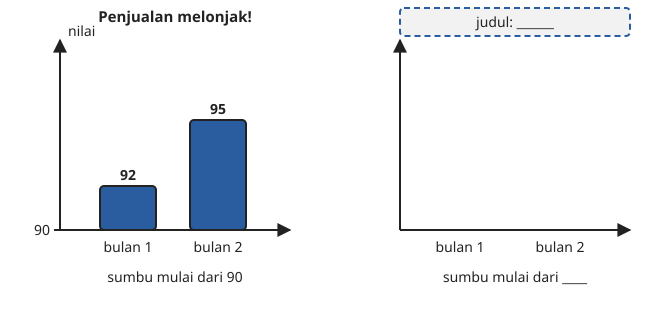

**Ingat dulu:** Tanpa melihat catatan, jawab. (1) Apa beda pengelompokan (tanpa label) dan klasifikasi? (2) Apa empat tahap alur dari data sampai keputusan, dan apa yang diperiksa di tiap tahap? ______

`[Gambar: di kiri grafik batang berjudul "Penjualan melonjak!" dengan sumbu tegak mulai dari 90 dan dua batang bernilai 92 dan 95. Di kanan sumbu kosong berlabel "perbaiki grafiknya" untuk digambar ulang oleh pelajar, dengan kotak isian judul yang jujur.]`

**Prediksi:** Penjualan enam bulan sebuah kantin fiktif (porsi, data karangan): 52, 53, 55, 54, 56, 57. Dua grafik batang memakai data yang sama persis: Grafik A dengan sumbu mulai dari 50 dan Grafik B dengan sumbu mulai dari 0. Tebak dan tulis: (1) grafik mana yang membuat penjualan tampak melonjak, (2) pada grafik itu, batang bulan 6 tampak berapa kali batang bulan 1, (3) berapa persen kenaikan sebenarnya dari bulan 1 ke bulan 6.

(1) ______ (2) ______ (3) ______

**Lengkapi:** Grafik batang fiktif pada gambar memakai sumbu mulai dari 90 dan menampilkan nilai 92 dan 95.

1. Tinggi batang pertama ____ satuan dan batang kedua ____ satuan, jadi batang kedua tampak ____ kali batang pertama.
2. Kenaikan sebenarnya = (____ - ____) / ____ = ____ persen (satu angka desimal).
3. Perbaikan grafik: sumbu mulai dari ____. Gambar ulang di sumbu kosong.
4. Tulis judul yang jujur: ______________________________
5. Satu kalimat batasan yang sebaiknya ditambahkan: ______________________________

**Susun:** Urutkan langkah membuat visual yang jujur.

- **A.** tulis pesan satu kalimat sebagai judul, lalu periksa apakah data mendukungnya
- **B.** tentukan pertanyaan yang ingin dijawab pembaca
- **C.** beri label sumbu, satuan, sumber, dan catatan bahwa data karangan
- **D.** pilih jenis grafik yang cocok untuk pertanyaan itu dan atur sumbunya
- **E.** tulis satu kalimat batasan dan minta teman memeriksa apakah ia salah membaca

Urutan: ____ , ____ , ____ , ____ , ____

**Latihan:**

1. (`AI: tanpa AI`) Pilih jenis grafik dan beri satu alasan untuk tiap pertanyaan: (a) kebun mana panennya terbesar, (b) bagaimana panen kebun C berubah tiga bulan, (c) apakah panjang dan berat kerang berhubungan, (d) bagaimana sebaran waktu tempuh bus. ______________________________
2. (`AI: tanpa AI`) Delapan waktu tempuh bus fiktif: 15, 16, 15, 17, 16, 15, 16, 60. Hitung rata-rata dan median, lalu hitung keduanya tanpa angka 60 dan jelaskan perbedaannya. ______________________________
3. (`AI: boleh`) Tulis satu halaman visual dengan judul pesan, satu atau dua grafik, sumber, dan satu kalimat batasan, dari data panen karangan. ______________________________

**Cek diri:**

- [ ] Saya dapat memilih jenis grafik menurut pertanyaan.
- [ ] Saya dapat menunjukkan sumbu yang menyesatkan dan menghitung perubahan sebenarnya.
- [ ] Saya menulis judul yang didukung data.

**Catatan cetak (untuk guru, tidak dicetak):** satu lembar A4, satu halaman. Kunci ada di modul `d-x2-m9`, bagian "Contoh terselesaikan" dan "Kunci dan petunjuk". Lembar tidak memuat kolom nama, kelas, tanggal, atau nilai.
