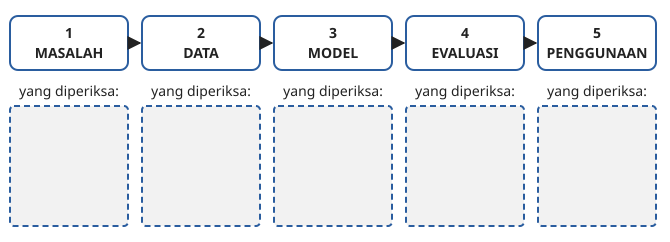

**Ingat dulu:** Tanpa melihat catatan, jawab. (1) Apa beda positif palsu dan negatif palsu, dan mengapa dampaknya bisa berbeda? (2) Apa saja isi rencana proyek yang ditulis sebelum mengerjakan? (3) Mengapa prediksi ditulis sebelum menjalankan model? ______



`[Gambar: lima kotak berpanah berurutan: 1 Masalah, 2 Data, 3 Model, 4 Evaluasi, 5 Penggunaan. Di bawah tiap kotak ada satu kotak isian kosong untuk menulis satu hal yang diperiksa pada tahap itu.]`

**Prediksi:** Sebuah sekolah fiktif ingin model yang memprediksi apakah sebuah laptop pinjaman akan rusak bulan depan. Dari data karangan, 5 dari 100 laptop rusak tiap bulan. Seorang murid membuat "model" yang selalu menjawab `tidak rusak`. Tebak dan tulis: (1) berapa persen tebakannya benar, (2) berapa laptop rusak yang berhasil ia peringatkan, (3) apakah model ini layak dipakai.

(1) ______ (2) ______ (3) ______________________________

**Lengkapi:** Lengkapi rancangan satu halaman untuk saringan pesan fiktif "KotakMasuk Contoh", yang menandai pesan sebagai `spam`.

```text
1 Masalah  : Pengguna memutuskan membuka atau mengabaikan pesan.
             Positif palsu: ____.  Negatif palsu: ____.
2 Data     : 2.000 pesan karangan. Yang dicek: ____, ____.
3 Model    : Pembanding: ____ (selalu menjawab kelas terbanyak).
4 Evaluasi : Pesan uji dipisah ____ model dilatih.
             Yang dilaporkan selain ketepatan: ____.
5 Penggunaan: Pesan yang ditandai spam ____ (dihapus / disimpan di folder).
```

**Susun:** Urutkan langkah menjadi alur proyek yang masuk akal.

- **A.** tulis prediksi hasil sebelum menjalankan model
- **B.** tentukan siapa yang terkena bila model salah
- **C.** periksa sumber dan lisensi data
- **D.** jalankan model dan evaluasi di data uji
- **E.** bandingkan dengan pembanding sederhana
- **F.** putuskan: dipakai, diperbaiki, atau ditolak

Urutan: ____ , ____ , ____ , ____ , ____ , ____

**Latihan:**

1. (`AI: tanpa AI`) Sebuah aplikasi fiktif ingin menyarankan jam belajar terbaik tiap murid. Tulis satu kalimat untuk tiap dari lima tahap. ______________________________
2. (`AI: boleh`) Rancangan: "Kita latih model pada semua data lalu ukur ketepatannya pada data yang sama." Sebut tiga kelemahan dan perbaikannya. ______________________________
3. (`AI: tanpa AI`) Pada saringan pesan fiktif, tulis akibat positif palsu dan negatif palsu bagi pengguna, lalu pilih yang lebih mahal. ______________________________

**Cek diri:**

- [ ] Saya dapat menyebut lima tahap proyek dan satu pemeriksaan di tiap tahap.
- [ ] Saya dapat menulis siapa yang terkena bila model salah.
- [ ] Saya menulis pembanding sederhana sebelum memilih model.

**Catatan cetak (untuk guru, tidak dicetak):** satu lembar A4, satu halaman. Kunci ada di modul `d-xi1-m1`, bagian "Contoh terselesaikan" dan "Kunci dan petunjuk". Lembar tidak memuat kolom nama, kelas, tanggal, atau nilai.
