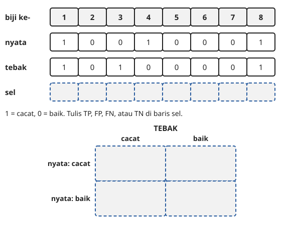

**Ingat dulu:** Tanpa melihat catatan, jawab. (1) Mengapa ketepatan uji 1,000 pada 12 baris belum membuktikan model sempurna? (2) Mengapa model tidak boleh dinilai pada data latih, dan bagaimana data dibagi? ______



`[Gambar: tabel delapan kolom bernomor 1 sampai 8 dengan baris nyata (1, 0, 0, 1, 0, 0, 0, 1) dan baris tebak (1, 0, 1, 0, 0, 0, 0, 1), serta baris sel yang kosong untuk menulis TP, FP, FN, atau TN. Di bawahnya matriks kebingungan dua kali dua yang kosong dengan baris nyata cacat dan baik serta kolom tebak cacat dan baik.]`

**Prediksi:** Tebak dan tulis dua keluaran, baru jalankan. Angka `1` berarti "cacat".

```python
nyata = [1, 0, 0, 1, 0, 0, 0, 1]
tebak = [1, 0, 1, 0, 0, 0, 0, 1]
tp = sum(1 for n, t in zip(nyata, tebak) if n == 1 and t == 1)
fp = sum(1 for n, t in zip(nyata, tebak) if n == 0 and t == 1)
fn = sum(1 for n, t in zip(nyata, tebak) if n == 1 and t == 0)
print(tp, fp, fn)
print(sum(n == t for n, t in zip(nyata, tebak)) / len(nyata))
```

Keluaran: ______ , ______. Dari semua biji yang sungguh cacat, berapa yang ketahuan? ______

**Lengkapi:** Presisi = TP / (TP + FP): dari yang ditebak cacat, berapa yang sungguh cacat. Recall = TP / (TP + FN): dari yang sungguh cacat, berapa yang ketahuan. Isi bagian `____`.

```python setengah-jadi
tp, fp, fn = 3, 1, 5
presisi = tp / (tp + ____)
recall = tp / (tp + ____)
print(round(presisi, 2), round(recall, 2))
```

**Susun:** Susun baris menjadi program yang menghitung recall dari dua daftar. Lekukan tidak dipakai; yang diacak hanya urutannya.

```text
A. print(recall_score(nyata, tebak))
B. tebak = [1, 0, 0, 0]
C. from sklearn.metrics import recall_score
D. nyata = [1, 1, 0, 0]
```

Urutan: ____ , ____ , ____ , ____

**Latihan:**

1. (`AI: tanpa AI`) Dari 100 biji, 8 cacat. Sebuah model menjawab "baik" untuk semuanya. Tulis ketepatan dan recall-nya, lalu satu kalimat mengapa model itu tidak berguna. ______________________________
2. (`AI: tanpa AI`) Tulis rencana empat baris untuk menilai penggolong biji cacat: cara membagi data, pembanding sederhana, metrik utama, dan alasan memilih metrik itu. Lalu hitung presisi dan recall dari `nyata = [1, 1, 0, 0, 1, 0]` dan `tebak = [1, 0, 0, 1, 1, 0]` dengan tangan. ______________________________

**Cek diri:**

- [ ] Saya dapat membaca matriks kebingungan dan menghitung ketepatan, presisi, dan recall.
- [ ] Saya dapat memilih metrik utama berdasarkan dampak kesalahan.
- [ ] Saya menulis rencana evaluasi sebelum menjalankan model.

**Catatan cetak (untuk guru, tidak dicetak):** satu lembar A4, satu halaman. Kunci ada di modul `d-xi1-m10`, bagian "Kunci dan petunjuk". Lembar tidak memuat kolom nama, kelas, tanggal, atau nilai.
