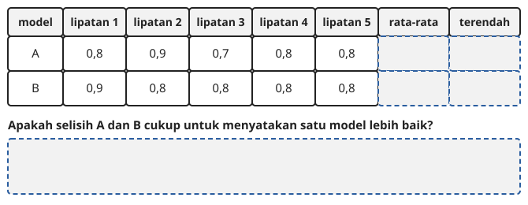

**Ingat dulu:** Tanpa melihat catatan, jawab. (1) Apa untungnya fungsi yang menerima masukan dan mengembalikan hasil dibanding mengubah variabel di luar fungsi? (2) Mengapa model yang menang pada satu data belum tentu menang pada data lain? (3) Apa beda presisi dan recall, dan kapan recall lebih penting? ______



`[Gambar: tabel dengan baris model A (0,8; 0,9; 0,7; 0,8; 0,8) dan model B (0,9; 0,8; 0,8; 0,8; 0,8) untuk lima lipatan, serta kolom rata-rata dan skor terendah yang kosong. Di bawahnya satu kotak kosong untuk menulis apakah selisihnya cukup untuk menyatakan satu model lebih baik.]`

**Prediksi:** Tebak dan tulis dua keluaran, baru jalankan.

```python
def pilih_terbaik(skor):
    terbaik = None
    for nama in skor:
        if terbaik is None or skor[nama] > skor[terbaik]:
            terbaik = nama
    return terbaik


print(pilih_terbaik({"a": 0.8, "b": 0.85, "c": 0.85}))
print(pilih_terbaik({"a": 0.7}))
```

Keluaran: ______ , ______. Bila `b` dan `c` memang sama baik, apakah pantas memilih `b` hanya karena ia disebut lebih dulu? ______

**Lengkapi:** Isi bagian `____` supaya fungsi mengembalikan rata-rata dan skor terendah dari daftar skor lipatan.

```python setengah-jadi
def ringkas(skor):
    rata = sum(skor) / ____(skor)
    return {"rata": round(rata, 2), "terendah": ____(skor)}


print(ringkas([0.83, 0.92, 1.0, 0.67, 0.83]))
```

**Susun:** Susun baris menjadi fungsi `selisih` dan pemanggilannya. Lekukan sudah ditulis dan harus dipertahankan; yang diacak hanya urutan barisnya.

```text
A.     return abs(a - b)
B. print(round(selisih(0.85, 0.82), 2))
C. def selisih(a, b):
```

Urutan: ____ , ____ , ____

**Latihan:**

1. (`AI: tanpa AI`) Isi tabel pada gambar: tulis rata-rata dan skor terendah masing-masing model, lalu apakah selisihnya cukup untuk menyatakan B lebih baik. ______________________________
2. (`AI: tanpa AI`) Sebelum menjalankan apa pun, tulis kolom tabel perbandingan dan tiga kriteria pemilihan model untuk penggolong biji cacat (sebutkan metrik utama). Lalu tulis fungsi yang mengembalikan recall rata-rata dengan `cross_val_score(..., scoring="recall")`. ______________________________
3. (`AI: boleh`) Buat data sintetis dua kelas buatanmu (aturannya tampak di kode), bandingkan tiga model, dan tulis satu paragraf pilihan modelmu: angka, alasan, kelemahan, dan jenis kesalahan yang paling berbahaya. ______________________________

**Cek diri:**

- [ ] Saya dapat menulis fungsi yang menilai model dan mengembalikan ringkasan.
- [ ] Saya membandingkan model pada data, lipatan, dan metrik yang sama.
- [ ] Saya membaca selisih skor terhadap simpangan antar lipatan.

**Catatan cetak (untuk guru, tidak dicetak):** satu lembar A4, satu halaman. Kunci ada di modul `d-xi1-m11`, bagian "Kunci dan petunjuk". Lembar tidak memuat kolom nama, kelas, tanggal, atau nilai.
