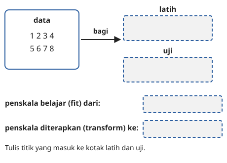

**Ingat dulu:** Tanpa melihat catatan, jawab. (1) Mengapa berkas data mentah tidak ditimpa, dan hasil olahan ditulis ke berkas baru? (2) Mengapa pembanding mayoritas dijalankan sebelum model? (3) Mengapa selisih kecil antar model pada data kecil belum membuktikan pemenang? ______



`[Gambar: satu kotak data berisi delapan titik 1 sampai 8, anak panah berlabel "bagi" menuju kotak latih dan kotak uji yang kosong untuk diisi titiknya. Di bawahnya dua kotak isian: "penskala belajar (fit) dari: ______" dan "penskala diterapkan (transform) ke: ______".]`

**Prediksi:** Tebak dan tulis keluaran sebelum menjalankan. Bagian latih tidak berisi baris `5`.

```python
from sklearn.neighbors import KNeighborsClassifier

X_latih = [[1], [2], [8], [9]]
y_latih = [0, 0, 1, 1]
model = KNeighborsClassifier(n_neighbors=1).fit(X_latih, y_latih)
print(model.score([[2], [8]], [0, 1]))
print(model.predict([[5.4]]))
```

Keluaran: ______ , ______. Apakah ketepatan 1,0 pada titik uji `[2]` dan `[8]` membuktikan model akan benar pada titik 5? ______

**Lengkapi:** Isi bagian `____` supaya penskala hanya belajar dari data latih lalu diterapkan ke data uji.

```python setengah-jadi
from sklearn.preprocessing import StandardScaler

X_latih = [[1.0], [2.0], [3.0]]
X_uji = [[10.0]]
skala = StandardScaler()
skala.____(X_latih)
print(skala.____(X_uji).round(2).tolist())
```

**Susun:** Susun baris menjadi program yang membagi dulu, baru mempelajari penskala dari data latih. Lekukan tidak dipakai; yang diacak hanya urutannya.

```text
A. skala = StandardScaler().fit(X_latih)
B. from sklearn.preprocessing import StandardScaler
C. X_latih, X_uji = train_test_split(X, test_size=0.25, random_state=0)
D. print(len(skala.transform(X_uji)))
E. from sklearn.model_selection import train_test_split
F. X = [[1.0], [2.0], [3.0], [4.0], [5.0], [6.0], [7.0], [8.0]]
```

Urutan: ____ , ____ , ____ , ____ , ____ , ____

**Latihan:**

1. (`AI: tanpa AI`) Untuk tiap kasus, tulis bocor atau tidak, dan alasannya: (a) memprediksi apakah murid fiktif lulus ulangan memakai kolom "nilai ulangan susulan"; (b) menormalkan seluruh kolom lalu membagi data; (c) mengacak data suhu harian lalu membagi, untuk memprediksi suhu esok; (d) membagi data dulu, baru mengisi nilai hilang dengan median data latih. ______________________________
2. (`AI: tanpa AI`) Tulis lima pertanyaan yang kamu ajukan ketika sebuah model mendapat ketepatan sangat tinggi. Lalu tulis satu baris `pandas` untuk menghitung jumlah baris kembar pada sebuah tabel. ______________________________
3. (`AI: boleh`) Hitung "terbaik dari N percobaan" untuk N = 1, 5, dan 30 pada tabel berlabel acak, dan bandingkan dengan rata-ratanya. Tulis satu kalimat tentang apa yang terjadi pada angka terbaik bila N makin besar. ______________________________

**Cek diri:**

- [ ] Saya dapat menyebut tiga bentuk kebocoran data dan contohnya.
- [ ] Saya membagi dulu, lalu mengolah dengan penskala yang belajar dari data latih.
- [ ] Saya mencurigai ketepatan yang terlalu tinggi dan menulis pertanyaan pemeriksanya.

**Catatan cetak (untuk guru, tidak dicetak):** satu lembar A4, satu halaman. Kunci ada di modul `d-xi1-m12`, bagian "Kunci dan petunjuk". Lembar tidak memuat kolom nama, kelas, tanggal, atau nilai.
