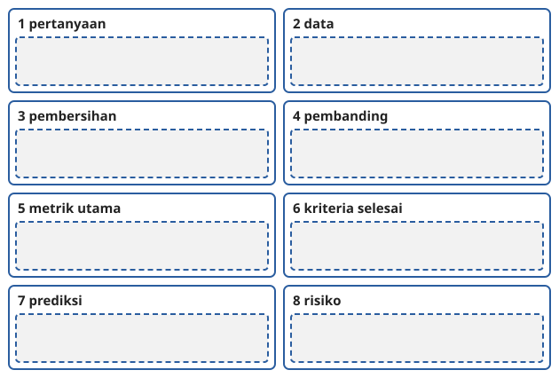

**Ingat dulu:** Tanpa melihat catatan, jawab. (1) Apa yang dicantumkan di laporan proyek tentang sumber data dan perubahan yang dilakukan padanya? (2) Mengapa sumbu grafik batang harus mulai dari nol? (3) Apa itu kebocoran data, dan sebutkan dua contohnya? ______

`[Gambar: halaman rencana proyek dengan delapan kotak berjudul pertanyaan, data, pembersihan, pembanding, metrik utama, kriteria selesai, prediksi, dan risiko. Tiap kotak kosong untuk diisi pelajar sebelum menulis kode.]`

**Lengkapi:** Tulis rencana **sebelum** kode, lalu simpan; membandingkannya dengan hasil adalah bagian belajarnya. Isi kotak pada gambar untuk proyek mini milikmu (data karangan atau terbuka berlisensi, tanpa data pribadi):

1. **Pertanyaan:** apa yang ditebak, untuk keputusan apa. ______
2. **Data:** sumber dan lisensi, atau pembangkit yang ditandai "karangan". ______
3. **Pembersihan:** apa yang akan diperiksa dan dicatat. ______
4. **Pembanding:** ______
5. **Metrik utama** dengan alasan dari dampak kesalahan: ______
6. **Kriteria selesai:** ______
7. **Prediksi** angka pembanding dan model: ______
8. **Risiko** (kebocoran, data pribadi): ______

**Latihan:**

1. (`AI: boleh`) Tukar proyek dengan kelompok lain dan beri umpan balik dalam tiga kalimat: satu yang sudah baik, satu yang perlu diperbaiki, satu langkah berikutnya, masing-masing menunjuk bagian tertentu (baris kode atau angka di laporan). Pakai nama kelompok atau nomor, bukan nama orang. ______________________________

**Cek diri:**

- [ ] Saya menulis rencana dan prediksi sebelum mengerjakan.
- [ ] Saya mencatat sumber data, keputusan pembersihan, dan batas kesimpulan.
- [ ] Saya membandingkan model dengan pembanding pada pengaturan yang sama dan memeriksa kebocoran.

**Catatan cetak (untuk guru, tidak dicetak):** satu lembar A4, satu halaman. Modul ini berupa proyek mini, jadi bagian Prediksi dan Susun dilewati. Kunci dan contoh ada di modul `d-xi1-m13`, bagian "Rencana proyek" dan "Daftar periksa". Lembar tidak memuat kolom nama, kelas, tanggal, atau nilai.
