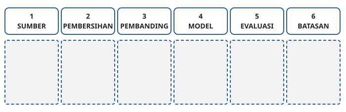

**Ingat dulu:** Jawab lima pertanyaan ini dari ingatan, di kertas, sebelum membuka kunci. Yang masih lupa dicatat untuk diulang, bukan dihukum.

1. Mengapa berkas data mentah tidak ditimpa, dan hasil olahan ditulis ke berkas baru? ______________________________
2. Sebutkan tiga keputusan pembersihan yang dicatat di laporan: apa yang ditemukan, berapa baris, dan mengapa tindakan itu dipilih. ______________________________
3. Mengapa galat prediksi dihitung pada data yang tidak dipakai menyusun prediksinya? ______________________________
4. Sebutkan empat hal yang dibandingkan di tabel perbandingan model. ______________________________
5. Apa isi laporan proyek data? Tulis satu kalimat tiap bagian pada gambar. ______________________________

`[Gambar: enam kotak bernomor berurutan: sumber, pembersihan, pembanding, model, evaluasi, batasan. Di bawah tiap kotak ada satu kotak isian kosong untuk menulis isi bagian itu.]`

**Cek diri:**

- [ ] Saya menjawab Ingat kembali dari ingatan sebelum membuka kunci.
- [ ] Saya menelusuri program di kertas sebelum menjalankannya.
- [ ] Saya dapat menyebut dua bentuk kebocoran data dan perbaikannya.

**Catatan cetak (untuk guru, tidak dicetak):** satu lembar A4, satu halaman. Modul ini berupa asesmen formatif dan refleksi, jadi bagian Prediksi, Lengkapi, Susun, dan Latihan dilewati; refleksi ditulis pelajar di buku catatannya sendiri dan tidak dikumpulkan. Kunci ada di modul `d-xi1-m14`, bagian "Kunci dan petunjuk". Lembar tidak memuat kolom nama, kelas, tanggal, atau nilai.
