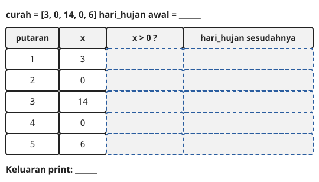

**Ingat dulu:** Tanpa melihat catatan, jawab. (1) Sebutkan lima tahap proyek data dan AI, dan satu hal yang diperiksa di tiap tahap. (2) Mengapa prediksi ditulis sebelum menjalankan model? ______



`[Gambar: tabel penelusuran untuk daftar curah = [3, 0, 14, 0, 6]. Lima baris berisi nilai x (3, 0, 14, 0, 6); kolom "x > 0 ?" dan kolom "hari_hujan sesudahnya" kosong. Di atas tabel ada baris "hari_hujan awal = ______".]`

**Prediksi:** Baca kode ini. Jangan dijalankan dulu. Tulis lima baris keluarannya.

```python
a = 7
b = 2
print(a / b)
print(a // b)
print(a % b)
print("7" + "2")
print(int("7") + int("2"))
```

1. ______  2. ______  3. ______  4. ______  5. ______

**Lengkapi:** Isi bagian `____` supaya program menghitung rata-rata suhu dan berapa hari bersuhu 30 derajat atau lebih. Data karangan.

```python setengah-jadi
suhu = [28, 31, 30, 35, 29]    # derajat Celsius, data karangan

jumlah = ____
for t in suhu:
    jumlah = jumlah + ____

rata = jumlah / ____
print(rata)

panas = 0
for t in suhu:
    if t ____ 30:
        panas = panas + 1
print(panas)
```

**Susun:** Susun baris-baris ini menjadi program yang menghitung berapa hari ada hujan. Lekukan sudah benar; yang diacak hanya urutannya.

```text
A.         hari_hujan = hari_hujan + 1
B. print(hari_hujan)
C. hari_hujan = 0
D. for x in curah:
E. curah = [3, 0, 14, 0, 6]
F.     if x > 0:
```

Urutan: ____ , ____ , ____ , ____ , ____ , ____. Lalu telusuri program itu pada tabel di gambar.

**Latihan:**

1. (`AI: tanpa AI`) Untuk `[5, 12, 8, 20]`, tulis program yang mencetak jumlah dan rata-ratanya dengan perulangan. ______________________________
2. (`AI: tanpa AI`) Tulis potongan kondisi yang menghasilkan `sangat panas` untuk 35 ke atas, `panas` untuk 30 sampai kurang dari 35, dan `sejuk` di bawahnya. Coba 36, 30, dan 29. ______________________________
3. (`AI: tanpa AI`) Tulis dalam kata-kata langkah mencari nilai terkecil dari sederet angka, baru ubah ke Python. ______________________________

**Cek diri:**

- [ ] Saya dapat menyebut tipe sebuah nilai dan menjelaskan mengapa `"7" + "2"` bukan 9.
- [ ] Saya dapat menulis `for` yang menjumlahkan dan menghitung cacah.
- [ ] Saya menulis langkah dalam kata-kata sebelum menulis kode.

**Catatan cetak (untuk guru, tidak dicetak):** satu lembar A4, satu halaman. Kunci ada di modul `d-xi1-m2`, bagian "Kunci dan petunjuk". Lembar tidak memuat kolom nama, kelas, tanggal, atau nilai.
