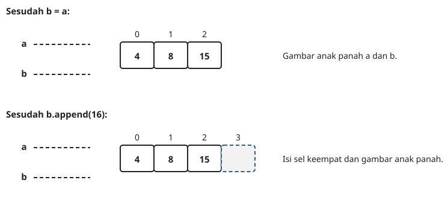

**Ingat dulu:** Tanpa melihat catatan, jawab. (1) Apa keluaran `7 / 2`, `7 // 2`, dan `7 % 2`, dan kapan memakai masing-masing? (2) Mengapa `"7" + "2"` menghasilkan `72`, dan bagaimana mendapat 9? ______



`[Gambar: dua label a dan b di kiri, satu anak panah dari a dan satu dari b yang belum tergambar sampai ujungnya, ke satu daftar [4, 8, 15] dengan indeks 0, 1, 2 di atas tiap sel. Di bawahnya daftar yang sama dengan empat sel, sel keempat kosong, untuk menggambar keadaan sesudah b.append(16).]`

**Prediksi:** Tebak dan tulis keluaran, baru jalankan.

```python
a = [4, 8, 15]
b = a
b.append(16)
print(len(a))
print(a[1:3])
tinggi = {"Ani": 150, "Budi": 160}
print(tinggi["Budi"])
print(tinggi.get("Cici", -1))
```

Keluaran: ______ , ______ , ______ , ______. Tulis juga: mengapa `len(a)` tidak 3, padahal yang ditambah `b`? Gambarkan pada gambar. ______________________________

**Lengkapi:** Lengkapi fungsi yang mencari kategori dengan cacah terbanyak dari sebuah kamus cacah.

```python setengah-jadi
def terbanyak(data):
    """Kembalikan kunci dengan jumlah terbesar."""
    nama_terbaik = None
    nilai_terbaik = ____
    for nama, jumlah in data.items():
        if jumlah ____ nilai_terbaik:
            nama_terbaik = ____
            nilai_terbaik = jumlah
    return nama_terbaik


print(terbanyak({"ringan": 3, "sedang": 5, "lebat": 2}))
```

**Susun:** Susun baris menjadi fungsi yang menjumlahkan bilangan genap dari sebuah daftar, lalu mencoba `[3, 4, 7, 10]`. Lekukan sudah benar; yang diacak hanya urutannya.

```text
A.     return total
B. print(jumlah_genap([3, 4, 7, 10]))
C.         if x % 2 == 0:
D. def jumlah_genap(daftar):
E.     total = 0
F.             total = total + x
G.     for x in daftar:
```

Urutan: ____ , ____ , ____ , ____ , ____ , ____ , ____

**Latihan:**

1. (`AI: tanpa AI`) Tulis `banyak_di_atas(daftar, batas)` yang mengembalikan banyaknya nilai yang lebih besar dari `batas`. Coba `[12, 0, 5, 30, 8]` dengan batas 10. ______________________________
2. (`AI: tanpa AI`) Tulis dalam kata-kata langkah menghitung berapa kali tiap huruf muncul di `["a", "b", "a", "c", "a"]`, baru ubah ke Python dengan kamus. ______________________________
3. (`AI: boleh`) Buat daftar `x = [3, 1, 2]`, salin ke `y`, urutkan `y` dengan `y.sort()`, lalu tunjukkan bahwa `x` tidak berubah. ______________________________

**Cek diri:**

- [ ] Saya dapat menulis fungsi dengan parameter dan `return`.
- [ ] Saya dapat menjelaskan mengapa `b = a` tidak menyalin daftar.
- [ ] Saya dapat menghitung kemunculan dengan kamus dan `.get`.

**Catatan cetak (untuk guru, tidak dicetak):** satu lembar A4, satu halaman. Kunci ada di modul `d-xi1-m3`, bagian "Kunci dan petunjuk". Lembar tidak memuat kolom nama, kelas, tanggal, atau nilai.
